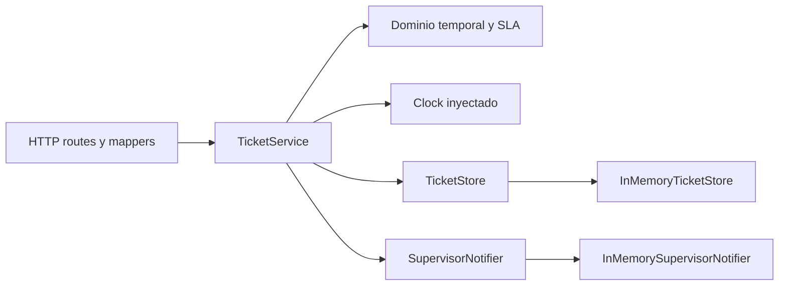
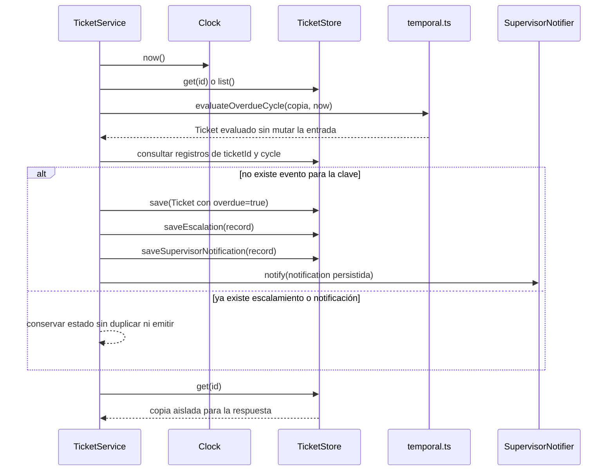

# Diseño técnico: notificaciones de vencimiento al supervisor

## Overview

La feature `ticket-expiry-supervisor-notifications` agrega al flujo existente de TicketOps la evaluación observable del vencimiento de un Ticket y el registro de un escalamiento y una notificación al Supervisor. `requirements.md` es la fuente de verdad funcional para este diseño.

La feature no introduce un worker, un temporizador global, una cola ni una dependencia externa. Las operaciones existentes de `TicketService` que alcanzan Tickets ejecutan la evaluación con un instante obtenido de `Clock` antes de devolver la representación correspondiente. La evaluación de la regla temporal vive en `src/domain/temporal.ts`; la aplicación coordina el almacenamiento y la emisión observable.

Decisiones principales:

- El vencimiento es estricto: un Ticket vence sólo cuando `now > dueAt`. La igualdad exacta con `dueAt` conserva el Ticket dentro del SLA.
- `dueAt` continúa siendo el valor calculado por el SLA de resolución existente. La feature no calcula un plazo alternativo.
- Sólo los estados no terminales (`NUEVO`, `ASIGNADO`, `EN_PROGRESO`, `EN_ESPERA`) pueden generar un evento nuevo. `RESUELTO` y `CERRADO` conservan los eventos históricos y no generan nuevos eventos al evaluarse.
- El primer ciclo es `overdueCycle: 1`. Una reapertura válida incrementa el ciclo, reinicia `overdue` a `false` y conserva los eventos anteriores.
- La unidad de idempotencia es `(ticketId, cycle)`. Para un ciclo se conserva como máximo un `EscalationRecord`, una `SupervisorNotification` persistida y una emisión al `SupervisorNotifier`.
- La primera evaluación vencida crea el escalamiento y la notificación con el mismo `ticketId`, `cycle` y `notifiedAt`. `escalatedAt` también usa el instante controlado de esa evaluación.
- `TicketStore` y `SupervisorNotifier` reciben y devuelven copias aisladas. Las fechas y colecciones anidadas se copian en cada frontera.
- HTTP serializa fechas con `toISOString()` y conserva identificadores, ciclos, indicadores y eventos sin recalcularlos.

### Alcance y trazabilidad

| Área del diseño | Requisitos cubiertos | Decisión |
|---|---:|---|
| Regla temporal y SLA | 1.1–1.5 | Reutilizar `isTicketOverdue`/`isOverdueAt`; comparar con `dueAt` calculado por SLA. |
| Primer registro | 2.1–2.5 | Crear un par coherente de escalamiento y notificación, persistirlo y emitirlo una vez. |
| Idempotencia | 3.1–3.4 | Consultar registros existentes por `(ticketId, cycle)` antes de persistir o notificar. |
| Persistencia y aislamiento | 4.1–4.5 | Usar las interfaces actuales y copias profundas en las implementaciones en memoria. |
| Estados terminales | 5.1–5.4 | Conservar indicador e historial; no crear eventos nuevos en evaluaciones terminales. |
| Reapertura | 6.1–6.5 | Usar `startOverdueCycle` al reabrir y mantener eventos por ciclo. |
| Activación observable | 7.1–7.5 | Evaluar desde `get`, `list`, `listOverdue`, `assign` y `changeStatus` antes de responder. |
| Contrato y serialización | 8.1–8.5 | Mantener los tipos existentes y mapear fechas a ISO UTC. |

### Investigación aplicada

El diseño se basa en la revisión del código existente:

- `src/domain/temporal.ts` ya contiene `isOverdueAt`, `isTicketOverdue`, `startOverdueCycle` y `evaluateOverdueCycle`. Estas funciones copian Tickets, aplican la comparación estricta y excluyen estados terminales.
- `src/domain/sla.ts` calcula `dueAt` según la prioridad; no se agrega una duración paralela.
- `src/domain/types.ts` ya define `Ticket`, `EscalationRecord` y `SupervisorNotification` con los campos exigidos.
- `src/application/ticket-service.ts` ya concentra la coordinación en `evaluateAndSave` y evalúa todos los Tickets antes de filtrar `listOverdue`.
- `src/infrastructure/contracts.ts` ya define `Clock`, `TicketStore` y `SupervisorNotifier`; no se modifica el contrato ni se agrega una dependencia externa.
- `src/infrastructure/in-memory-ticket-store.ts` y `src/infrastructure/in-memory-supervisor-notifier.ts` ya establecen copias defensivas de Tickets, fechas, registros e historial.
- `src/http/mappers.ts` ya expone `overdue`, `overdueCycle`, `escalations` y `supervisorNotifications`, y convierte fechas a ISO UTC.
- Las pruebas existentes usan Vitest, `fast-check`, un `FixedClock` y al menos 100 ejecuciones para propiedades. La estrategia conserva esas convenciones.

La semántica de serialización se apoya en [`Date.prototype.toISOString`](https://developer.mozilla.org/en-US/docs/Web/JavaScript/Reference/Global_Objects/Date/toISOString). Las pruebas continúan usando [`Vitest`](https://vitest.dev/) y [`fast-check`](https://fast-check.dev/), ya presentes en el proyecto; no se introduce ninguna biblioteca nueva.

## Architecture

### Capas y dependencias



- **Dominio (`src/domain/`)**: define tipos, estados terminales, el cálculo de `dueAt`, la predicación de vencimiento, la reapertura y la evaluación pura. No conoce `Clock`, `TicketStore`, HTTP ni `SupervisorNotifier`.
- **Aplicación (`src/application/`)**: obtiene el instante, carga copias, llama a la regla de dominio, reconcilia los registros existentes y coordina el orden de persistencia y notificación.
- **Infraestructura (`src/infrastructure/`)**: implementa las interfaces existentes para reloj, almacenamiento, directorio de agentes y notificador. El almacenamiento en memoria es la persistencia de ejecución requerida por esta feature.
- **HTTP (`src/http/`)**: valida entradas, invoca el servicio y serializa fechas. No decide si un Ticket está vencido ni crea eventos.

La dependencia fluye hacia el dominio. Las implementaciones concretas se inyectan por `TicketServiceDependencies`; esto permite usar `FixedClock`, Store en memoria y notificador inspeccionable en pruebas.

### Flujo de evaluación

```mermaid
flowchart TD
    START[Operación de TicketService] --> NOW[Obtener Clock.now]
    NOW --> READ[Leer copia del Ticket o lista de Tickets]
    READ --> EVAL[evaluateOverdueCycle(ticket, now)]
    EVAL --> RULE{now > dueAt y estado no terminal?}
    RULE -- No --> SAVE_STATE[Conservar indicador e historial; guardar estado evaluado]
    RULE -- Sí --> KEY{Existe escalamiento o notificación para ticketId/cycle?}
    KEY -- Sí --> NO_DUP[No guardar duplicados; no emitir otra notificación]
    KEY -- No --> BUILD[Crear escalamiento y notificación coherentes]
    BUILD --> SAVE_TICKET[Guardar Ticket evaluado]
    SAVE_TICKET --> SAVE_ESC[Guardar EscalationRecord]
    SAVE_ESC --> SAVE_NOTIF[Guardar SupervisorNotification]
    SAVE_NOTIF --> EMIT[SupervisorNotifier.notify]
    NO_DUP --> RESULT[Leer copia final y devolver]
    SAVE_STATE --> RESULT
    EMIT --> RESULT
```

La condición de vencimiento es `now > dueAt && !isTerminalStatus(status)`. La igualdad exacta y los instantes anteriores no crean eventos. En estado terminal, la evaluación conserva `overdue` histórico y todos los registros ya existentes.

### Secuencia del primer vencimiento



El orden lógico es `Ticket -> EscalationRecord -> SupervisorNotification -> notify`. Así, el notificador nunca recibe un registro que no haya sido persistido previamente. Las implementaciones en memoria son síncronas. Si se adopta un Store persistente en el futuro, la misma unidad deberá protegerse con una transacción, una restricción única o un mecanismo equivalente.

### Activación por operaciones observables

`TicketService` conserva estos puntos de activación:

- `create` calcula `dueAt`, inicializa `overdueCycle: 1`, `overdue: false` y colecciones vacías. No evalúa antes de guardar un Ticket nuevo.
- `get` obtiene `Clock.now()`, evalúa y guarda antes de devolver el Ticket.
- `list` obtiene un único instante para la operación, evalúa cada Ticket y aplica los filtros después de la evaluación.
- `listOverdue` valida al Supervisor, obtiene un único instante, evalúa todos los Tickets y filtra después por vencimiento y categoría. Un Ticket que no aparece en la respuesta también queda evaluado si fue alcanzado por la operación.
- `assign` valida actor y agente antes de mutar, luego evalúa con el instante de la operación y guarda la asignación.
- `changeStatus` valida la transición y la nota antes de mutar, luego evalúa, aplica el cambio y usa `startOverdueCycle` sólo en una reapertura válida.

Una operación que no alcanza un Ticket no dispara su evaluación ni promete una notificación fuera de los puntos anteriores.

## Components and Interfaces

### Regla de dominio: `src/domain/temporal.ts`

Se reutilizan las funciones existentes:

```ts
export function isOverdueAt(
  now: Date,
  dueAt: Date,
  status: TicketStatus,
): boolean;

export function isTicketOverdue(
  ticket: Pick<Ticket, 'dueAt' | 'status'>,
  now: Date,
): boolean;

export function startOverdueCycle(ticket: Ticket): Ticket;

export function evaluateOverdueCycle(ticket: Ticket, now: Date): Ticket;
```

`isOverdueAt` es la única definición de la comparación temporal. `evaluateOverdueCycle` recibe el instante como argumento, devuelve una copia y nunca lee el reloj del sistema ni muta el Ticket de entrada.

Al evaluar un Ticket no terminal posterior a `dueAt`, la función marca `overdue: true` y prepara como máximo un registro de cada tipo para el ciclo activo. Si el Ticket no está vencido, conserva los eventos y deja `overdue: false` en estados no terminales. Si el Ticket está terminal, conserva el indicador histórico y los eventos.

`startOverdueCycle` devuelve una copia, incrementa `overdueCycle` en uno, reinicia `overdue` a `false` y conserva las colecciones de eventos anteriores. `changeStatus` debe llamarla sólo para `RESUELTO -> EN_PROGRESO` o `CERRADO -> EN_PROGRESO`.

### `TicketService`

El método privado `evaluateAndSave(ticket, now)` es el coordinador único de efectos de vencimiento:

1. Recibe una copia del `TicketStore` y un `Date` ya obtenido de `Clock`.
2. Llama a `evaluateOverdueCycle(ticket, now)`.
3. Consulta los registros persistidos para `ticket.id` y determina si ya existe escalamiento o notificación para el `cycle` activo.
4. Guarda el Ticket evaluado.
5. Si la clave no existía, persiste el escalamiento y la notificación del ciclo y emite la notificación después de guardarla.
6. Si ya existía cualquiera de los registros para la clave, no vuelve a persistir ni a emitir para ese ciclo.
7. Devuelve una nueva copia leída del Store.

La decisión de idempotencia usa `(ticketId, cycle)`, no sólo `cycle`, para impedir que dos Tickets con el mismo número de ciclo compartan eventos. En la ruta normal, la evaluación crea el par completo. Si se encuentra un estado parcial preexistente, la operación respeta la regla de idempotencia y no crea un segundo registro ni emite una nueva notificación; la implementación persistente futura debe evitar producir estados parciales mediante una unidad atómica.

### Interfaces existentes de infraestructura

Se reutilizan exactamente las interfaces de `src/infrastructure/contracts.ts`:

```ts
export interface Clock {
  now(): Date;
}

export interface TicketStore {
  get(id: string): Ticket | undefined;
  list(): Ticket[];
  save(ticket: Ticket): void;
  saveHistory(entry: StateHistoryEntry): void;
  listHistory(ticketId: string): StateHistoryEntry[];
  saveEscalation(record: EscalationRecord): void;
  listEscalations(ticketId?: string): EscalationRecord[];
  saveSupervisorNotification(record: SupervisorNotification): void;
  listSupervisorNotifications(ticketId?: string): SupervisorNotification[];
}

export interface SupervisorNotifier {
  notify(record: SupervisorNotification): void;
}
```

No se añade un método de consulta por ciclo: el servicio puede obtener los registros del Ticket y comparar `ticketId` y `cycle` en memoria. Tampoco se añade una dependencia de reloj, base de datos o mensajería.

### `InMemoryTicketStore`

La implementación conserva cuatro mapas independientes:

- `Map<string, Ticket>` para Tickets.
- `Map<string, StateHistoryEntry[]>` para el historial de estados.
- `Map<string, EscalationRecord[]>` para escalamientos.
- `Map<string, SupervisorNotification[]>` para notificaciones.

`save`, `saveEscalation` y `saveSupervisorNotification` guardan copias. `get`, `list`, `listHistory`, `listEscalations` y `listSupervisorNotifications` devuelven copias nuevas, incluyendo copias de todas las fechas y colecciones anidadas. Los eventos se agrupan primariamente por `ticketId`; el servicio aplica la clave compuesta `(ticketId, cycle)`.

### `InMemorySupervisorNotifier`

`notify` recibe la notificación persistida y guarda una copia aislada en una lista inspeccionable. `list`, `listNotifications` y `notifications` devuelven copias. La clase no decide si un evento es nuevo; esa decisión corresponde a `TicketService` y al Store.

### HTTP y mappers

`src/http/mappers.ts` es la única frontera de serialización de esta feature. `mapTicketToResponse`, `mapEscalationToResponse` y `mapSupervisorNotificationToResponse`:

- convierten cada `Date` a `toISOString()`;
- conservan `ticketId`, `cycle`, `escalatedAt` y `notifiedAt`;
- exponen `overdue` y `overdueCycle` sin recalcularlos;
- exponen `escalations` y `supervisorNotifications` como `[]` cuando no hay eventos;
- no mutan el Ticket ni alteran los registros.

La autorización y validación HTTP permanecen en las capas existentes. HTTP no duplica `isOverdueAt` ni crea registros.

## Data Models

### Entidades y registros

Los tipos existentes en `src/domain/types.ts` son la forma canónica:

```ts
type TicketStatus =
  | 'NUEVO'
  | 'ASIGNADO'
  | 'EN_PROGRESO'
  | 'EN_ESPERA'
  | 'RESUELTO'
  | 'CERRADO';

interface EscalationRecord {
  ticketId: string;
  cycle: number;
  escalatedAt: Date;
  notifiedAt: Date;
}

interface SupervisorNotification {
  ticketId: string;
  cycle: number;
  notifiedAt: Date;
}
```

Un `Ticket` conserva los campos operativos existentes y añade o mantiene estos campos de vencimiento:

```ts
interface Ticket {
  id: string;
  status: TicketStatus;
  dueAt: Date;
  overdue: boolean;
  overdueCycle: number;
  escalations: EscalationRecord[];
  supervisorNotifications: SupervisorNotification[];
  // demás campos operativos existentes
}
```

El primer Ticket inicia con `overdueCycle: 1`, `overdue: false` y colecciones vacías. `cycle` es positivo y corresponde a `overdueCycle` del ciclo que originó el evento. Un evento no cambia de ciclo ni de Ticket al serializarse.

### Invariantes por `(ticketId, cycle)`

1. Existe como máximo un escalamiento y como máximo una notificación persistida para la clave.
2. En el primer registro normal, ambos registros comparten `ticketId`, `cycle` y `notifiedAt`.
3. `EscalationRecord` siempre contiene `ticketId`, `cycle`, `escalatedAt` y `notifiedAt`.
4. `SupervisorNotification` siempre contiene `ticketId`, `cycle` y `notifiedAt`.
5. Una emisión al `SupervisorNotifier` corresponde a una notificación previamente persistida.
6. Ningún evento de un Ticket puede aparecer bajo otro `ticketId`.
7. Resolver, cerrar o reabrir no elimina eventos de ciclos anteriores.
8. Las lecturas y entregas a dependencias no comparten referencias mutables con el Store.

### Reapertura y estados terminales

Al pasar de `RESUELTO` o `CERRADO` a `EN_PROGRESO`, el servicio usa `startOverdueCycle`: incrementa el ciclo, reinicia `overdue`, conserva eventos históricos y deja el Ticket listo para una evaluación independiente sobre el nuevo ciclo. `dueAt` no se recalcula porque los requisitos definen el nuevo ciclo sobre el vencimiento existente.

Cuando un Ticket vencido cambia a `RESUELTO` o `CERRADO`, el servicio conserva `overdue: true`, los escalamientos y las notificaciones. Una evaluación posterior del Ticket terminal no añade eventos. Si el Ticket llega a un estado terminal antes de superar `dueAt`, conserva `overdue: false` y no crea registros para ese ciclo.

### Representación HTTP

Los registros externos tienen estas formas:

```ts
interface HttpEscalation {
  ticketId: string;
  cycle: number;
  escalatedAt: string;
  notifiedAt: string;
}

interface HttpSupervisorNotification {
  ticketId: string;
  cycle: number;
  notifiedAt: string;
}
```

`HttpTicket` conserva `overdue`, `overdueCycle`, `escalations` y `supervisorNotifications`, además de los campos operativos y las transiciones permitidas existentes. Las fechas se exponen como cadenas ISO UTC. Las colecciones sin eventos se exponen como arreglos vacíos.

## Correctness Properties

Una propiedad es una característica o comportamiento que debe mantenerse en todas las ejecuciones válidas de un sistema. Es una afirmación formal que conecta los requisitos con pruebas automatizadas. PBT es apropiado aquí para la regla temporal, las transformaciones puras, la idempotencia, el aislamiento, el particionamiento por Ticket y la serialización; los efectos de infraestructura y las rutas HTTP también requieren pruebas de integración concretas.

### Property 1: Vencimiento estricto y exclusión de estados terminales

**For any** Ticket válido, estado y instante `now`, `isTicketOverdue(ticket, now)` será verdadero exactamente cuando `now` sea posterior a `dueAt` y el estado no sea `RESUELTO` ni `CERRADO`; para un instante anterior o igual, o para un estado terminal, `evaluateOverdueCycle` no añadirá eventos nuevos.

**Validates: Requirements 1.1, 1.2, 1.3, 1.4, 5.4**

### Property 2: El primer vencimiento crea un par coherente

**For any** Ticket no terminal sin eventos del ciclo activo y cualquier instante posterior a `dueAt`, `evaluateOverdueCycle` devolverá `overdue: true`, un escalamiento y una notificación para el mismo `ticketId` y `cycle`; ambos compartirán `notifiedAt` y el escalamiento tendrá `escalatedAt`.

**Validates: Requirements 2.1, 2.2, 2.4, 8.1, 8.2, 8.3**

### Property 3: La evaluación es idempotente por `(ticketId, cycle)`

**For any** Ticket vencido y cualquier secuencia no vacía de evaluaciones posteriores sobre el mismo `(ticketId, cycle)`, el estado observable final tendrá como máximo un escalamiento, como máximo una notificación persistida y como máximo una emisión al `SupervisorNotifier`; la repetición tendrá el mismo resultado que una sola evaluación posterior a `dueAt`.

**Validates: Requirements 3.1, 3.2, 3.3, 6.5**

### Property 4: La evaluación no muta la entrada

**For any** Ticket válido con fechas y registros anidados, evaluar el Ticket devolverá copias aisladas: mutar la entrada después de evaluar no cambiará el resultado, y mutar el resultado no cambiará la entrada ni los datos previamente almacenados.

**Validates: Requirements 3.4**

### Property 5: El Store aísla y particiona por Ticket

**For any** conjunto de Tickets con identificadores distintos y eventos de ciclos distintos, guardar y leer cada Ticket o evento devolverá sólo los registros de su `ticketId`; modificar una copia leída no cambiará otra lectura ni contaminará otro Ticket.

**Validates: Requirements 4.1, 4.2, 4.4**

### Property 6: La reapertura conserva la historia e inicia un ciclo

**For any** Ticket en `RESUELTO` o `CERRADO` con eventos históricos, aplicar una reapertura válida producirá `overdueCycle + 1` y `overdue: false`, conservará sin cambios los eventos anteriores y dejará el nuevo ciclo disponible para una evaluación independiente.

**Validates: Requirements 6.1, 6.3, 6.4**

### Property 7: El instante inyectado gobierna el cálculo y los registros

**For any** instante válido entregado por un `Clock` controlado y cualquier Ticket no terminal que venza en ese instante, `overdue`, `escalatedAt` y `notifiedAt` se determinarán usando ese instante, sin leer el reloj del sistema.

**Validates: Requirements 7.4**

### Property 8: La serialización conserva identidad, ciclos y tiempo

**For any** Ticket con cero o más eventos válidos, mapearlo a HTTP conservará el `ticketId`, el `cycle` y la identidad de cada evento, y cada fecha serializada representará el mismo instante UTC que su `Date` de origen; un Ticket sin eventos se mapeará a colecciones vacías.

**Validates: Requirements 2.5, 8.4, 8.5**

### Reflexión de propiedades

Las propiedades se consolidan para evitar pruebas redundantes:

- La propiedad 1 reúne los casos anterior, igual, posterior y terminal porque todos dependen de la misma predicación temporal.
- La propiedad 2 reúne la creación del par, sus campos obligatorios y la conservación del indicador porque son invariantes del primer evento.
- La propiedad 3 reúne repetición desde el servicio y presencia previa en el Store porque ambas expresan la misma clave de idempotencia.
- La propiedad 5 combina aislamiento y separación de Tickets, ya que ambas se verifican con copias y particionamiento del Store.
- Los criterios sobre autorización, orden de efectos, transiciones concretas y ausencia de dependencia externa no se fuerzan como propiedades universales; se cubren con ejemplos, integración y smoke tests.

## Error Handling

### Errores de entrada y dominio

- Si `TicketStore.get` no encuentra el identificador, `TicketService` lanza `TicketNotFoundError` y no evalúa ni persiste eventos para un Ticket inexistente.
- `Clock.now()` debe entregar un `Date` válido. Un instante inválido es un error de configuración de la dependencia; la operación debe fallar antes de persistir y no debe sustituirlo por la hora del sistema ni por un plazo predeterminado.
- Actores ausentes o desconocidos, agentes inactivos, falta de autorización de Supervisor, notas de resolución inválidas y transiciones no permitidas se validan antes de mutar. El error conserva el Ticket y sus eventos sin cambios.
- Un Ticket terminal vencido históricamente no es un error. Se conserva su evidencia y una evaluación posterior no crea un evento nuevo.
- Un Ticket terminalizado antes de `dueAt` conserva `overdue: false` y no recibe registros de vencimiento.

### Idempotencia y estados parciales

La comprobación de la clave `(ticketId, cycle)` se realiza antes de persistir o emitir. Si el Store ya contiene un escalamiento o una notificación de esa clave, se evita una nueva persistencia y una nueva invocación del notificador, conforme a Requirement 3.3. La ruta normal crea ambos registros en una sola evaluación lógica.

Las interfaces existentes no ofrecen transacciones. Las implementaciones en memoria realizan escrituras síncronas y el servicio conserva el orden `saveSupervisorNotification` antes de `notify`. Una implementación persistente futura deberá usar una transacción, una restricción única o un mecanismo equivalente para que una interrupción no produzca duplicados. Un estado parcial legado se conserva sin duplicar ni volver a emitir; corregirlo automáticamente queda fuera del alcance porque no debe violar la idempotencia definida por el Store.

Si `TicketStore` falla, el servicio propaga el error y no llama al notificador antes de la persistencia de la notificación. Si `SupervisorNotifier.notify` falla después de guardar, el registro persistido permanece para impedir una segunda emisión en el siguiente intento. La entrega garantizada o reintentable requeriría un outbox, que no forma parte de esta feature.

### Serialización y HTTP

Los mappers no capturan ni ocultan errores de datos inválidos. Un `Date` inválido que impida `toISOString()` se propaga al manejador de errores existente como indicación de corrupción o configuración incorrecta. HTTP valida entradas en los esquemas existentes y no recalcula el vencimiento ni modifica registros.

## Testing Strategy

La estrategia combina pruebas de propiedades, unitarias, de integración y smoke tests. PBT se limita a lógica propia con entradas variables y bajo coste. Las dependencias y efectos observables se verifican con dobles deterministas y ejemplos de integración.

### Pruebas property-based

Se usará `fast-check` con Vitest, sin implementar un generador de PBT propio. Cada propiedad de esta sección se implementará con un único test basado en `fc.property` y `{ numRuns: 100 }` como mínimo. Cada test incluirá un comentario con este formato:

```ts
// Feature: ticket-expiry-supervisor-notifications, Property N: [texto de la propiedad]
```

| Propiedad | Unidad | Variación |
|---|---|---|
| 1 | `isOverdueAt`, `isTicketOverdue`, `evaluateOverdueCycle` | Instantes antes, iguales y después de `dueAt`; estados terminales y no terminales. |
| 2 | `evaluateOverdueCycle` | Tickets válidos, ciclos positivos, instantes posteriores y colecciones vacías. |
| 3 | `TicketService` con Store y Notifier en memoria | Secuencias de `get`/consultas sobre el mismo Ticket y ciclo, incluyendo registros ya existentes. |
| 4 | Dominio y Store | Fechas, eventos anidados y mutaciones de entrada y salida. |
| 5 | `InMemoryTicketStore` | Múltiples `ticketId`, ciclos intercalados y lecturas mutadas. |
| 6 | `startOverdueCycle` y flujo de reapertura | Tickets terminales con eventos de uno o varios ciclos. |
| 7 | `FixedClock` y servicio | Instantes controlados en ambos lados de la frontera y posterior a ella. |
| 8 | Mappers de Tickets y eventos | Colecciones vacías, múltiples eventos y fechas con milisegundos. |

### Pruebas unitarias

- `temporal.test.ts`: frontera anterior/igual/posterior, estados terminales, preservación de eventos y copias profundas.
- `InMemoryTicketStore`: copias en entrada y salida para Tickets, fechas, escalamientos, notificaciones e historial.
- `InMemorySupervisorNotifier`: copia aislada del registro recibido y lista inspeccionable.
- Mappers: ISO UTC, campos obligatorios, ciclos e identificadores sin alteración y arreglos vacíos.
- `TicketService`: Ticket inexistente, Clock inválido, transiciones inválidas, validación antes de mutar y ausencia de evaluación después de un fallo de validación.

### Pruebas de integración

Con `FixedClock`, `InMemoryTicketStore`, `InMemorySupervisorNotifier` y un `IdGenerator` determinista se verificarán:

1. creación con `dueAt` calculado por cada prioridad;
2. consulta antes de `dueAt`, exactamente en `dueAt` y después de `dueAt`;
3. primera evaluación con exactamente un escalamiento, una notificación persistida y una emisión;
4. consulta repetida e idempotencia por `(ticketId, cycle)`;
5. activación mediante `get`, `list`, `listOverdue`, `assign` y `changeStatus` antes de devolver la representación;
6. evaluación de todos los Tickets antes de filtrar `listOverdue`, incluso los que no aparecen en la respuesta;
7. resolución y cierre de Tickets vencidos sin pérdida de `overdue` ni eventos;
8. terminalización antes de `dueAt` sin crear registros;
9. reapertura desde `RESUELTO` y `CERRADO`, con historia previa y un nuevo ciclo;
10. evaluación del nuevo ciclo sin sobrescribir eventos anteriores;
11. separación de dos Tickets y conservación de `ticketId` en cada registro;
12. respuestas HTTP con `overdue`, `overdueCycle`, registros completos y fechas ISO UTC;
13. autorización de `listOverdue` y errores de operaciones inválidas sin efectos parciales.

### Smoke tests y límites

Un smoke test construirá el grafo completo con `TicketService`, `Clock`, Store y Notifier en memoria, registrará un vencimiento y comprobará que no se requiere red, base de datos, filesystem ni worker. No se medirán servicios externos porque la arquitectura de la feature no los utiliza.

No se usarán snapshots para la regla de vencimiento, ya que depende de fechas y estados. Para HTTP se prefieren aserciones de contrato sobre campos, ciclos, identificadores y fechas serializadas.

### Trazabilidad de criterios de aceptación

| Criterio | Diseño y prueba principal |
|---|---|
| 1.1 | Regla estricta en Architecture y Property 1; unit test antes de `dueAt`. |
| 1.2 | Property 1 e integración en igualdad exacta. |
| 1.3 | Property 1 e integración posterior para estado no terminal. |
| 1.4 | Property 1 e integración de estado terminal. |
| 1.5 | `dueAt` calculado por SLA en Overview, Components y prueba de creación por prioridad. |
| 2.1 | Flujo de primer vencimiento, Property 2 e integración de conteos exactos. |
| 2.2 | Invariantes por clave y Property 2. |
| 2.3 | Components, secuencia y prueba de persistencia antes de `notify`. |
| 2.4 | Property 2 e integración del indicador almacenado. |
| 2.5 | Mappers, Property 8 y aserciones ISO UTC. |
| 3.1 | Property 3 e integración de consultas repetidas. |
| 3.2 | `evaluateAndSave`, Property 3 y secuencia del servicio. |
| 3.3 | Regla explícita de clave existente, Error Handling y estado parcial. |
| 3.4 | Property 4 y pruebas de copias profundas. |
| 4.1 | Componentes de `InMemoryTicketStore` e integración de agrupación por Ticket/ciclo. |
| 4.2 | Property 5 y pruebas de aislamiento de lectura. |
| 4.3 | `InMemorySupervisorNotifier` y prueba de copia inspeccionable. |
| 4.4 | Property 5 e integración con dos `ticketId`. |
| 4.5 | Overview, Architecture y smoke test sin dependencia externa. |
| 5.1 | Data Models, Error Handling e integración al resolver un vencido. |
| 5.2 | Data Models, Error Handling e integración al cerrar un vencido. |
| 5.3 | Architecture, Property 3 e integración de evaluación terminal posterior. |
| 5.4 | Property 1 e integración de terminalización antes de `dueAt`. |
| 6.1 | `startOverdueCycle`, Property 6 y pruebas de reapertura. |
| 6.2 | Property 2 e integración del nuevo `cycle`. |
| 6.3 | Property 6 e integración antes de `dueAt` en el nuevo ciclo. |
| 6.4 | Property 6 e invariantes de conservación histórica. |
| 6.5 | Property 3 e integración de consultas repetidas tras reapertura. |
| 7.1 | Activación por operaciones observables e integración de representación final. |
| 7.2 | Flujo de `listOverdue` y prueba de evaluar antes de filtrar. |
| 7.3 | Activación observable y smoke/integración de Tickets no alcanzados. |
| 7.4 | Property 7 y pruebas con `FixedClock`. |
| 7.5 | Activación, mappers e integración de estado y eventos en la respuesta. |
| 8.1 | Tipos de dominio, Data Models y Property 2. |
| 8.2 | Tipos de dominio, Data Models y Property 2. |
| 8.3 | Invariantes, Components y prueba de emisión persistida. |
| 8.4 | Mappers, Property 8 e integración HTTP. |
| 8.5 | Data Models, mappers y prueba de arreglos vacíos. |

Los criterios clasificados como integración, ejemplo, borde o smoke no se convierten artificialmente en propiedades. Se verifican mediante los casos concretos indicados en esta estrategia, mientras que las propiedades cubren las invariantes universales de bajo coste.
