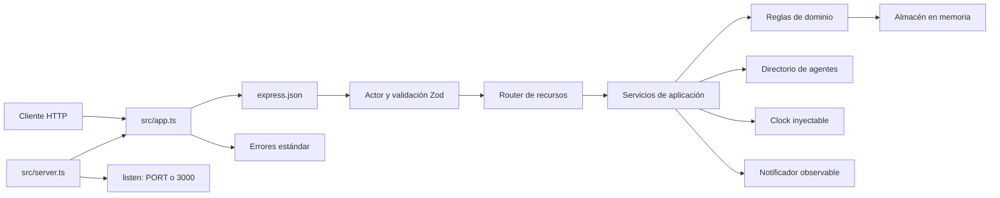

# Diseño técnico: TicketOps API

## Overview

TicketOps será una API REST en TypeScript para registrar, consultar y operar tickets operacionales durante la ejecución de un proceso. La primera versión conservará todos los datos únicamente en memoria: no usará base de datos, migraciones ni conexiones externas para iniciar o atender los endpoints especificados.

El diseño separa cuatro responsabilidades:

1. **Transporte HTTP**: Express recibe solicitudes, identifica rutas, valida entradas y serializa respuestas.
2. **Aplicación**: los servicios coordinan autorización, repositorios, transiciones, resolución, historial y SLA.
3. **Dominio**: los tipos, catálogos y reglas puras definen estados, transiciones, duración del SLA y vencimiento.
4. **Infraestructura sustituible**: el reloj, generador de identificadores, directorio de agentes, almacenamiento y notificador se inyectan.

`src/app.ts` exportará la instancia de Express sin abrir un puerto. `src/server.ts` será el único módulo que lea `PORT` y llame a `listen`, usando `3000` cuando la variable no exista. Las pruebas importarán `app` o `createApp()` y ejecutarán solicitudes en memoria.

### Alcance y trazabilidad

El diseño cubre Requirements 1–14: creación y validación de tickets, longitud máxima del título, consultas y filtros AND, asignación, máquina de estados, resolución y cierre, SLA y escalamiento, historial, contrato HTTP, salud, aislamiento en memoria, separación de arranque y aplicación, y scripts de construcción, pruebas y lint.

Las decisiones de contrato confirmadas son las siguientes:

- `responsibleId` es el nombre canónico del identificador del responsable. `POST /tickets` no acepta ese campo; todo ticket nuevo queda con `responsibleId: null` y la asignación ocurre exclusivamente mediante `PATCH /tickets/:id/assignment`.
- `responsibleId` se trata como una cadena opaca. Los tickets nuevos usan `crypto.randomUUID()` para sus identificadores; los fixtures del directorio de agentes pueden usar identificadores estables y legibles que se sustituyen en las pruebas.
- `PATCH /tickets/:id/status` permite reabrir tickets mediante `RESUELTO -> EN_PROGRESO` y `CERRADO -> EN_PROGRESO`. La reapertura conserva historial y eventos de SLA, limpia los datos de resolución y comienza un nuevo ciclo de vencimiento.

### Investigación aplicada

- La [guía de routing de Express 5](https://expressjs.com/en/5x/guide/routing.html) trata una ruta como la combinación de método y patrón. El diseño usa routers explícitos y una tabla de rutas para resolver también `405 Method Not Allowed`.
- La [guía de manejo de errores de Express 5](https://expressjs.com/en/5x/guide/error-handling.html) permite centralizar errores de middleware y handlers en un middleware de cuatro argumentos. El diseño normaliza esos errores al contrato estándar.
- [Zod](https://zod.dev/) valida datos no confiables en tiempo de ejecución e infiere tipos TypeScript desde esquemas. Se usará para cuerpos, parámetros y filtros.
- La documentación de [fake timers de Vitest](https://vitest.dev/guide/mocking/timers) permite controlar el tiempo en pruebas. El diseño usa como mecanismo principal un `Clock` inyectable y reserva fake timers para pruebas de integración del proceso cuando sea necesario.
- TypeScript 5.9 documenta sus cambios en las [notas de versión](https://www.typescriptlang.org/docs/handbook/release-notes/typescript-5-9.html). El proyecto fijará la serie `5.9.x` y no instalará TypeScript 7.
- La guía de [typescript-eslint](https://typescript-eslint.io/getting-started/) recomienda configuración flat para ESLint y reglas TypeScript recomendadas.
- La documentación de [pnpm](https://pnpm.io/cli/install) define la instalación reproducible. El proyecto usará pnpm y no requerirá npm o yarn.

## Architecture

### Flujo de una solicitud



### Capas y dependencias

- `src/app.ts`: crea y configura `express()`, `express.json()`, routers, validadores, middleware de método no permitido, fallback de ruta inexistente y error handler. No llama `listen`, no lee `PORT` y no crea timers globales.
- `src/server.ts`: importa `app`, lee `Number.parseInt(process.env.PORT ?? '3000', 10)`, valida el puerto y llama a `app.listen`. Un `PORT` ausente usa `3000`; un `PORT` válido usa su valor. Un valor inválido debe hacer fallar el arranque con un mensaje claro, porque los requisitos sólo definen el comportamiento de valores ausentes o válidos.
- `src/domain/`: uniones o enums de `Category`, `Priority`, `TicketStatus` y `ActorRole`; tabla de transiciones; tabla de SLA; tipos de tickets, historial y escalamiento; funciones puras de vencimiento.
- `src/application/`: casos de uso `createTicket`, `listTickets`, `getTicket`, `assignTicket`, `changeStatus`, `listHistory` y `listOverdue`.
- `src/infrastructure/`: `InMemoryTicketStore`, `InMemoryAgentDirectory`, `InMemorySupervisorNotifier`, `SystemClock` y `randomUuidGenerator`.
- `src/http/`: esquemas Zod, lectura de headers y query params, mappers de request/response, routers, tabla de rutas y error handler.
- `src/types/`: contratos compartidos que no pertenezcan claramente al dominio.

Las dependencias se inyectarán mediante `createApp(dependencies?)`. La exportación por defecto `app` usará dependencias en memoria para ejecución normal. Las pruebas podrán suministrar un almacén nuevo, reloj fijo, directorio controlado, generador determinista y notificador espía. Así se evita compartir datos entre pruebas y se comprueba que la aplicación no necesita una base de datos.

### Actor y autorización

El actor operativo se identifica con el header `X-Actor-Id` en las operaciones mutantes de asignación y estado. El valor se recorta y debe ser una cadena no vacía. Si falta o tiene tipo inválido, la operación devuelve `400` con el formato estándar. Si tiene un formato válido pero no está en el directorio, devuelve `400` con `ACTOR_UNKNOWN`.

El servidor no confiará en un header de rol enviado por el cliente. `AgentDirectory` resolverá el actor a `{ id, role, active }`, con roles mínimos `AGENT` y `SUPERVISOR`. `GET /tickets/overdue` exige un actor resuelto con rol `SUPERVISOR`; la ausencia, desconocimiento o rol insuficiente devuelve `403` con `SUPERVISOR_REQUIRED`.

El campo `requester` identifica al solicitante declarado en el ticket y no sustituye al actor operativo. La primera versión no exige que `requester` exista en el directorio.

## Components and Interfaces

### Interfaces de infraestructura

```ts
interface Clock {
  now(): Date;
}

interface TicketStore {
  get(id: string): Ticket | undefined;
  list(): Ticket[];
  save(ticket: Ticket): void;
  saveHistory(entry: StateHistoryEntry): void;
  listHistory(ticketId: string): StateHistoryEntry[];
  saveEscalation(record: EscalationRecord): void;
  listEscalations(ticketId?: string): EscalationRecord[];
  saveSupervisorNotification(record: SupervisorNotification): void;
  listSupervisorNotifications(ticketId?: string): SupervisorNotification[];
}

interface AgentDirectory {
  find(actorId: string): ActorRecord | undefined;
  isActiveAgent(agentId: string): boolean;
}

interface SupervisorNotifier {
  notify(record: SupervisorNotification): void;
}

interface IdGenerator {
  next(): string;
}
```

La implementación de producción de `IdGenerator` delegará en `crypto.randomUUID()`, por lo que los identificadores de tickets serán cadenas opacas y no incrementales. Las pruebas podrán inyectar un generador determinista; los fixtures de `AgentDirectory` pueden usar identificadores estables y legibles porque esos valores sólo representan agentes de prueba.

`InMemoryTicketStore` usará un `Map<string, Ticket>` y colecciones privadas para historial, escalamientos y notificaciones. El servicio copiará objetos al leerlos y antes de exponerlos para que una respuesta HTTP no pueda mutar el estado interno por referencia.

### Servicios de aplicación

- `TicketService.create(input)`: recibe únicamente los campos obligatorios validados, recorta textos, genera el identificador con `crypto.randomUUID()`, obtiene `createdAt` del `Clock`, calcula `dueAt`, inicializa `NUEVO`, `responsibleId: null`, `overdue: false`, `overdueCycle: 1` y colecciones vacías. `POST /tickets` no acepta `responsibleId`. `updatedAt` se inicializa con el mismo instante de creación.
- `TicketService.list(filters)`: evalúa vencimientos y devuelve sólo tickets que cumplen simultáneamente todos los filtros recibidos de `category`, `status` y `priority`.
- `TicketService.get(id)`: evalúa el vencimiento del ticket leído y devuelve una copia o lanza `NotFoundError`.
- `TicketService.assign(id, responsibleId, actorId)`: verifica ticket, actor y agente activo. Guarda el nuevo responsable y aplica `NUEVO -> ASIGNADO` sólo cuando el estado anterior es `NUEVO`; en los demás estados operativos no cambia el estado.
- `TicketService.changeStatus(id, target, resolutionNote, actorId)`: verifica actor y ticket, trata el mismo estado como no-op, valida la transición, exige nota al entrar a `RESUELTO`, fija `resolvedAt`, exige origen `RESUELTO` al entrar a `CERRADO`, y al reabrir desde `RESUELTO` o `CERRADO` limpia `resolvedAt`, `closedAt` y `resolutionNote`, incrementa `overdueCycle` y reinicia `overdue`. Después fija `closedAt` cuando corresponde, actualiza el historial y actualiza `updatedAt`.
- `TicketService.history(id)`: verifica que el ticket exista y devuelve las entradas ordenadas por fecha ascendente y por secuencia cuando dos fechas sean iguales.
- `TicketService.overdue(category?, supervisorId)`: verifica el rol de supervisor, evalúa todos los tickets contra el reloj actual, registra sólo eventos nuevos del ciclo activo y filtra por categoría después de evaluar.

La evaluación de vencimiento podrá ser llamada por las operaciones que leen o modifican tickets. No habrá un job de fondo en esta versión.

## Data Models

### Catálogos

```ts
type Category =
  | 'INFRAESTRUCTURA'
  | 'ACCESOS'
  | 'APLICACIONES'
  | 'INSTALACIONES';

type Priority = 'CRITICA' | 'ALTA' | 'MEDIA' | 'BAJA';

type TicketStatus =
  | 'NUEVO'
  | 'ASIGNADO'
  | 'EN_PROGRESO'
  | 'EN_ESPERA'
  | 'RESUELTO'
  | 'CERRADO';

type ActorRole = 'AGENT' | 'SUPERVISOR';
```

### Ticket interno

```ts
interface Ticket {
  id: string;
  title: string;
  description: string;
  category: Category;
  priority: Priority;
  requester: string;
  responsibleId: string | null;
  status: TicketStatus;
  createdAt: Date;
  updatedAt: Date;
  dueAt: Date;
  resolutionNote: string | null;
  resolvedAt: Date | null;
  closedAt: Date | null;
  overdue: boolean;
  overdueCycle: number;
  escalations: EscalationRecord[];
  supervisorNotifications: SupervisorNotification[];
}

interface StateHistoryEntry {
  sequence: number;
  ticketId: string;
  from: TicketStatus;
  to: TicketStatus;
  changedAt: Date;
  actorId: string;
}

interface EscalationRecord {
  ticketId: string;
  cycle: number;
  escalatedAt: Date;
  notifiedAt: Date;
}

interface SupervisorNotification {
  ticketId: string;
  cycle: number;
  notifiedAt: Date;
}

interface ActorRecord {
  id: string;
  role: ActorRole;
  active: boolean;
}
```

Las fechas serán `Date` dentro del dominio y se convertirán a `toISOString()` sólo en el mapper HTTP. La representación JSON incluirá `null` para `responsibleId`, `resolutionNote`, `resolvedAt` y `closedAt` cuando no existan, y arreglos vacíos para escalamientos y notificaciones. Cada fecha serializada será ISO 8601 en UTC.

`overdueCycle` empieza en `1`. El registro de escalamiento y la notificación de un mismo ciclo compartirán el ciclo y el instante de notificación. Los eventos históricos nunca se sobrescriben. Cuando un ciclo activo se evalúa por primera vez después de vencer, se guarda exactamente un escalamiento y una notificación. Los estados `RESUELTO` y `CERRADO` conservan el indicador y todos los eventos históricos.

La reapertura mediante `PATCH /tickets/:id/status` desde `RESUELTO` o `CERRADO` conserva historial, escalamientos y notificaciones anteriores; limpia `resolvedAt`, `closedAt` y `resolutionNote`, incrementa `overdueCycle` y reinicia `overdue` a `false` para el ciclo activo. Si el reloj ya está después de `dueAt`, la siguiente evaluación vuelve a marcar el ticket como vencido y registra exactamente un escalamiento y una notificación para el nuevo ciclo.

### Contrato de creación y validación

El cuerpo de `POST /tickets` debe contener exactamente, como mínimo, estos campos obligatorios:

```json
{
  "title": "No funciona el acceso VPN",
  "description": "El usuario no puede conectarse desde la oficina.",
  "category": "ACCESOS",
  "priority": "ALTA",
  "requester": "user-123"
}
```

El esquema `createTicketSchema` debe cumplir lo siguiente:

- `title`, `description` y `requester` son strings, se recortan y deben quedar no vacíos.
- `title` tiene una longitud máxima de 120 caracteres después de recortar espacios. Un valor de 121 caracteres o más se rechaza con `400` y el error estándar.
- `category` y `priority` son enums de los catálogos anteriores; un tipo incorrecto o valor desconocido se rechaza con `400`.
- La ausencia de cualquiera de los cinco campos obligatorios se rechaza con `400` y el error estándar.
- `POST /tickets` no acepta `responsibleId` ni variantes como `responsible` o `responsable`; todo ticket creado queda con `responsibleId: null`.

El esquema será estricto para impedir propiedades desconocidas. La asignación operacional ocurre exclusivamente mediante `PATCH /tickets/:id/assignment`, cuyo cuerpo contiene `{ "responsibleId": "..." }`. La regla de longitud se ejecutará sobre el texto ya recortado y no sobre el valor con espacios exteriores.

### Otros esquemas Zod

- `ticketFilterSchema`: `category`, `status` y `priority` opcionales y restringidos a sus enums.
- `assignmentSchema`: `responsibleId` obligatorio, string no vacío después de recortar; el esquema no decide si el agente existe o está activo.
- `statusSchema`: `status` obligatorio como enum y `resolutionNote` opcional como string. La exigencia de nota al resolver depende del estado anterior y pertenece al servicio.
- `actorHeaderSchema`: `X-Actor-Id` obligatorio para operaciones mutantes y no vacío después de recortar.
- `categoryFilterSchema`: `category` opcional como enum para overdue.
- `idParamSchema`: identificador de ruta como string no vacío.

Los errores de Zod se transformarán en `details` con ruta, mensaje y código. Las reglas que dependen del estado, actor, directorio o reloj no se duplicarán en Zod.

## Endpoints y contratos principales

| Método y ruta | Entrada | Éxito |
|---|---|---|
| `GET /` | Ninguna | `200`, nombre del servicio, estado y catálogo de rutas requerido |
| `GET /health` | Ninguna | `200`, exactamente `{ "status": "ok" }` |
| `POST /tickets` | JSON con `title`, `description`, `category`, `priority`, `requester`; no acepta `responsibleId` | `201`, ticket creado sin responsable |
| `GET /tickets` | Query opcional `category`, `status`, `priority` | `200`, arreglo de tickets; filtros combinados con AND |
| `GET /tickets/:id` | Parámetro `id` | `200`, ticket; `404` si no existe |
| `PATCH /tickets/:id/assignment` | `X-Actor-Id`; JSON `{ "responsibleId": "agent-1" }` | `200`, ticket actualizado |
| `PATCH /tickets/:id/status` | `X-Actor-Id`; JSON `{ "status": "RESUELTO", "resolutionNote": "..." }` cuando corresponda; también admite `RESUELTO` o `CERRADO` como estado actual y `EN_PROGRESO` como reapertura | `200`, ticket actualizado |
| `GET /tickets/:id/history` | Parámetro `id` | `200`, historial ascendente; `404` si no existe |
| `GET /tickets/overdue` | `X-Actor-Id` de supervisor; query opcional `category` | `200`, tickets vencidos; `403` sin permiso |

La ruta literal `/tickets/overdue` se registrará antes de `/tickets/:id`. Las respuestas de colección serán arreglos JSON. Las respuestas de ticket incluirán `overdue`, `dueAt`, fechas de resolución/cierre, `escalations` y `supervisorNotifications` para que los efectos de SLA sean observables.

`GET /` incluirá al menos `GET /`, `GET /health`, `POST /tickets`, `GET /tickets`, `GET /tickets/:id`, `PATCH /tickets/:id/assignment`, `PATCH /tickets/:id/status`, `GET /tickets/:id/history` y `GET /tickets/overdue`.

## Máquina de estados

La tabla de transiciones permitidas mediante `PATCH /tickets/:id/status` separa las transiciones normales de las reaperturas:

```text
Transiciones normales:
NUEVO        -> ASIGNADO
ASIGNADO     -> EN_PROGRESO
EN_PROGRESO  -> EN_ESPERA
EN_ESPERA    -> EN_PROGRESO
EN_PROGRESO  -> RESUELTO
EN_ESPERA    -> RESUELTO
RESUELTO     -> CERRADO

Transiciones de reapertura:
RESUELTO     -> EN_PROGRESO
CERRADO      -> EN_PROGRESO
```

Una asignación a un ticket en `NUEVO` aplica automáticamente `NUEVO -> ASIGNADO`. Una asignación sobre cualquier otro estado operativo cambia el responsable, pero no cambia el estado. Una reasignación sin cambio de estado no añade historial.

Un destino igual al estado actual se trata como no-op: devuelve el ticket sin cambiar `updatedAt` ni historial. Un destino diferente que no esté en las tablas anteriores devuelve `409` con el error estándar y no muta el ticket. Un estado ausente, inválido o de tipo incorrecto devuelve `400`.

Al entrar en `RESUELTO`, `resolutionNote` debe contener texto no vacío después de recortar. El servicio guarda la nota normalizada y `resolvedAt`. Al entrar en `CERRADO`, el estado anterior debe ser `RESUELTO` y se guarda `closedAt`. La resolución y el cierre conservan `overdue`, `escalations` y `supervisorNotifications`.

Al reabrir desde `RESUELTO` o `CERRADO`, el servicio conserva el historial de estados y todos los eventos históricos de SLA, limpia `resolvedAt`, `closedAt` y `resolutionNote`, incrementa `overdueCycle` y reinicia `overdue` para el ciclo activo. Si el reloj ya está después de `dueAt`, la siguiente evaluación registra los nuevos eventos de SLA de ese ciclo.

Los cambios reales de estado, incluidas las reaperturas, añaden una entrada de historial con estado anterior, nuevo estado, fecha y actor. La creación inicial en `NUEVO` no añade una entrada porque no es un cambio desde otro estado.

## SLA, hora actual y vencimiento

### Catálogo de SLA

| Prioridad | SLA de resolución | Duración |
|---|---:|---:|
| `CRITICA` | 4 horas | `4 * 60 * 60 * 1000` ms |
| `ALTA` | 8 horas | `8 * 60 * 60 * 1000` ms |
| `MEDIA` | 24 horas | `24 * 60 * 60 * 1000` ms |
| `BAJA` | 72 horas | `72 * 60 * 60 * 1000` ms |

En producción, `SystemClock.now()` obtiene la hora actual del proceso mediante `new Date()`. El dominio no llamará directamente a `Date.now()`; recibirá un `Clock` para que la fuente de hora sea explícita y sustituible.

Al crear un ticket:

```text
createdAt = clock.now()
dueAt = createdAt + sla(priority)
updatedAt = createdAt
```

El vencimiento usa comparación estricta:

```text
overdue = now > dueAt
         && status != RESUELTO
         && status != CERRADO
```

Por tanto, un ticket exactamente en `dueAt` todavía no está vencido. Cada consulta de overdue evalúa el instante actual antes de filtrar y responder. La evaluación diferida evita un job global y mantiene el comportamiento determinista.

### Reloj inyectable para pruebas

Las pruebas unitarias usarán `FixedClock` o un stub equivalente:

```ts
class FixedClock implements Clock {
  constructor(private current: Date) {}

  now(): Date {
    return new Date(this.current);
  }

  set(current: Date): void {
    this.current = new Date(current);
  }
}
```

El test puede crear un ticket con una hora fija, avanzar el reloj justo hasta `dueAt` y después avanzar un milisegundo. Así comprueba los límites del SLA sin esperar 4, 8, 24 o 72 horas reales. `vi.useFakeTimers()` podrá complementar las pruebas de integración que necesiten controlar la hora global, pero `Clock` seguirá siendo la fuente principal del dominio.

### Ciclos de vencimiento, escalamiento y notificación

Dentro de un ciclo activo, la primera evaluación con `now > dueAt` y estado distinto de `RESUELTO`/`CERRADO`:

1. marca `overdue: true`;
2. crea un `EscalationRecord`;
3. crea una `SupervisorNotification` observable en el almacén, notificador o respuesta del ticket;
4. registra `escalatedAt` y `notifiedAt` como fechas ISO en HTTP.

Las evaluaciones repetidas del mismo ciclo no duplican eventos. La resolución o cierre conserva el indicador y los registros. La reapertura desde `RESUELTO` o `CERRADO` incrementa `overdueCycle`, conserva los eventos anteriores y reinicia `overdue` a `false`. Si `now > dueAt` en la siguiente evaluación, el ticket vuelve a marcarse como vencido y se registra exactamente un escalamiento y una notificación con el nuevo número de ciclo. Las evaluaciones posteriores de ese ciclo siguen siendo idempotentes.

## Correctness Properties

Una propiedad de corrección es una característica que debe mantenerse para todas las ejecuciones válidas. Las propiedades siguientes se aplican a lógica de dominio, servicios y dependencias en memoria. Los contratos HTTP, configuración, arranque y efectos externos se cubren con pruebas de ejemplo, integración o smoke.

### Property 1: Creación conserva invariantes y campos obligatorios

Para cualquier entrada que cumpla el esquema de creación, el ticket conserva `title`, `description`, `category`, `priority` y `requester`, queda en `NUEVO`, tiene un identificador opaco generado por `crypto.randomUUID()`, tiene fechas válidas y queda con `responsibleId: null`. La asignación sólo puede ocurrir después mediante el endpoint de assignment.

**Validates: Requirements 1.1, 1.3, 2.1, 2.5**

### Property 2: Textos y título se validan después de recortar

Para cualquier combinación de textos de creación, un `title`, `description` o `requester` que queda vacío al recortarse se rechaza, y cualquier `title` recortado de longitud mayor que 120 se rechaza; un título recortado de longitud entre 1 y 120 cumple la regla de longitud.

**Validates: Requirements 1.6, 2.2, 2.3, 3.1, 3.2, 3.3**

### Property 3: Catálogos y tipos inválidos se rechazan

Para cualquier valor que no pertenezca al catálogo o no tenga el tipo esperado, la validación de `category` o `priority` rechaza la solicitud con un error de solicitud inválida y no crea un ticket.

**Validates: Requirements 1.7, 2.1, 2.4**

### Property 4: SLA y fecha de vencimiento son deterministas

Para cualquier prioridad válida y cualquier instante de creación, la duración corresponde al catálogo y `dueAt` es exactamente `createdAt + sla(priority)`.

**Validates: Requirements 1.2, 8.1**

### Property 5: Los filtros se aplican por intersección

Para cualquier colección de tickets y cualquier combinación válida de `category`, `status` y `priority`, el resultado contiene exactamente los tickets que cumplen simultáneamente todos los filtros recibidos.

**Validates: Requirements 4.4, 4.5, 4.6, 4.7**

### Property 6: La asignación aplica sólo la transición automática definida

Para cualquier ticket y agente activo, una asignación guarda el nuevo responsable; si el estado previo es `NUEVO`, pasa a `ASIGNADO`, y en cualquier otro estado permitido conserva el estado.

**Validates: Requirements 5.1, 5.2**

### Property 7: La máquina acepta exactamente las transiciones permitidas

Para cualquier estado origen y destino, una transición distinta de un no-op tiene éxito si y sólo si el par pertenece a la tabla de siete transiciones normales o a la tabla de dos transiciones de reapertura; cualquier otro par produce conflicto y deja el ticket sin cambios.

**Validates: Requirements 6.1, 6.3**

### Property 8: Las operaciones sin cambio no añaden historial

Para cualquier ticket y operación válida que no cambie el estado, el estado y el contenido y cantidad del historial permanecen iguales; una reasignación puede modificar únicamente el responsable y su fecha de actualización.

**Validates: Requirements 6.2, 9.5**

### Property 9: Las mutaciones reales actualizan el timestamp

Para cualquier asignación válida o transición real, si el `Clock` devuelve un instante posterior a `updatedAt`, el ticket resultante usa ese instante como `updatedAt`.

**Validates: Requirements 5.5, 6.6**

### Property 10: Resolver exige y conserva una nota

Para cualquier ticket en `EN_PROGRESO` o `EN_ESPERA`, la transición a `RESUELTO` se acepta exactamente cuando `resolutionNote` queda no vacía al recortarse; cuando se acepta, conserva la nota y fija `resolvedAt`.

**Validates: Requirements 7.1, 7.2, 7.3**

### Property 11: Cerrar respeta la precondición de resolución

Para cualquier ticket, pasar a `CERRADO` se acepta si y sólo si el estado anterior es `RESUELTO`; cuando se acepta, fija `closedAt`, y cuando se rechaza deja el ticket sin cambios.

**Validates: Requirements 7.4, 7.5, 7.6**

### Property 12: El predicado de vencimiento usa tiempo estricto y estado actual

Para cualquier ticket, instante actual y estado, el ticket es vencido exactamente cuando `now > dueAt` y el estado no es `RESUELTO` ni `CERRADO`; cuando `now === dueAt`, no es vencido.

**Validates: Requirements 8.2, 8.5**

### Property 13: Cada ciclo de vencimiento es idempotente

Para cualquier ticket que vence dentro de un ciclo activo, evaluar una o muchas veces produce exactamente un escalamiento y una notificación para ese ciclo, con fechas de evento consistentes.

**Validates: Requirements 8.3**

### Property 14: La reapertura conserva eventos y comienza un ciclo nuevo

Para cualquier ticket resuelto o cerrado con historial y eventos de SLA, reabrirlo a `EN_PROGRESO` conserva todas las entradas y eventos anteriores, limpia `resolvedAt`, `closedAt` y `resolutionNote`, incrementa `overdueCycle` y reinicia `overdue`; si `now > dueAt` en la siguiente evaluación, añade exactamente un escalamiento y una notificación para el nuevo ciclo sin duplicar los eventos anteriores.

**Validates: Requirements 8.3, 8.4**

### Property 15: Cada cambio real genera historial ordenado y atribuible

Para cualquier secuencia de transiciones válidas y actores identificables, cada cambio real genera exactamente una entrada con estado anterior, estado nuevo, fecha y actor; las entradas se ordenan por fecha ascendente y por secuencia cuando las fechas empatan.

**Validates: Requirements 9.1, 9.2**

#### Reflexión sobre redundancias

La Property 2 combina la validación de textos vacíos y de longitud porque ambas dependen del mismo valor de `title` normalizado. La Property 5 consolida filtros individuales y combinados porque la intersección cubre todos los subconjuntos. La Property 7 consolida aceptación y rechazo de las tablas de transiciones normales y de reapertura. La Property 8 cubre conjuntamente los no-op de estado y las reasignaciones que no cambian de estado. La Property 12 no se fusiona con la Property 13: la primera prueba el predicado temporal y la segunda la idempotencia de efectos dentro de un ciclo. La Property 14 conserva valor independiente porque verifica la limpieza de los datos de resolución, la permanencia histórica y la creación de otro ciclo.

## Error Handling

Todos los errores usarán este formato JSON, sin stack trace ni detalles internos:

```json
{
  "error": {
    "code": "INVALID_REQUEST",
    "message": "Request validation failed",
    "details": [
      { "path": ["title"], "message": "Required", "code": "invalid_type" }
    ]
  }
}
```

`details` es opcional y se usará principalmente para errores Zod. Códigos previstos:

| Situación | HTTP | `error.code` |
|---|---:|---|
| Cuerpo, query, parámetro o entrada inválida | 400 | `INVALID_REQUEST` |
| Actor ausente o inválido | 400 | `ACTOR_REQUIRED` |
| Actor desconocido | 400 | `ACTOR_UNKNOWN` |
| JSON mal formado | 400 | `INVALID_JSON` |
| Actor sin permiso de supervisor | 403 | `SUPERVISOR_REQUIRED` |
| Ticket o historial inexistente | 404 | `TICKET_NOT_FOUND` |
| Ruta inexistente | 404 | `ROUTE_NOT_FOUND` |
| Agente inexistente o inactivo | 409 | `AGENT_UNAVAILABLE` |
| Transición no permitida | 409 | `INVALID_TRANSITION` |
| Método no permitido en ruta conocida | 405 | `METHOD_NOT_ALLOWED` |
| Error no previsto | 500 | `INTERNAL_ERROR` |

El orden de middleware será:

1. `express.json()`.
2. Normalizador de `SyntaxError` producido por JSON inválido.
3. Routers y handlers.
4. Middleware de método no permitido basado en la tabla de rutas y la cabecera `Allow`.
5. Fallback de ruta inexistente.
6. Error handler con firma `(error, request, response, next)`.

Un método incorrecto sobre una ruta conocida, como `POST /health`, devuelve `405`; una ruta desconocida devuelve `404`. Los errores de recurso inexistente se distinguen del fallback y usan `TICKET_NOT_FOUND`. Una reapertura válida usa la respuesta de éxito normal de cambio de estado; una reapertura con estado ausente o inválido devuelve `400`, y cualquier transición no permitida devuelve `409` con `INVALID_TRANSITION`. Los errores de validación y autorización no mutan el almacén.

## Testing Strategy

### Decisión sobre PBT

PBT es apropiado para las reglas puras y los servicios en memoria porque reciben entradas variadas y deben conservar invariantes universales: normalización, longitud, SLA, filtros, transiciones, no-op, resolución, historial y ciclos. No se usará PBT para probar que Express, Node, un navegador o un servicio externo se comporta internamente; esos casos usarán ejemplos, integración o smoke tests.

### Herramientas y configuración

- Node.js 20 o superior.
- Express como framework HTTP.
- Zod para validación en runtime.
- Vitest en ejecución única mediante `vitest run`.
- `fast-check` como biblioteca PBT; no se implementarán generadores propios desde cero.
- ESLint con configuración flat y `typescript-eslint` sobre el código TypeScript.
- TypeScript fijado a `5.9.x`, con `strict: true`, `rootDir: src`, `outDir: dist` y exclusión de `src/**/*.test.ts` de la salida.
- pnpm como gestor, con `packageManager` fijado a la versión acordada del proyecto. Los flujos documentados serán pnpm, no npm ni yarn.
- `supertest` para enviar solicitudes a `createApp()` sin abrir un puerto.

Cada propiedad tendrá una sola prueba PBT y al menos 100 ejecuciones:

```ts
// Feature: ticketops-api, Property 4: SLA y fecha de vencimiento son deterministas
fc.assert(property, { numRuns: 100 });
```

Los almacenes, directorios y relojes serán nuevos por prueba. Los relojes falsos se restaurarán en `afterEach`. Las propiedades 1–15 se implementarán con una prueba PBT cada una y al menos 100 ejecuciones; la Property 14 cubre directamente las transiciones de reapertura confirmadas.

### Pruebas unitarias

- Catálogos, tabla SLA, cálculo de `dueAt` y predicado `now > dueAt`.
- Esquema de creación: presencia, tipos, textos recortados, `title` de 120 caracteres y `title` de 121 caracteres; rechazo de `responsibleId` en `POST /tickets`.
- Validadores de filtros, assignment, status y actor, incluyendo el tratamiento opaco de `responsibleId`.
- Tabla exacta de transiciones normales y de reapertura, no-op, notas de resolución, limpieza al reabrir y cierre.
- Mappers de `Date` a ISO UTC y formato estándar de errores.
- Repositorio en memoria, secuencia del historial e idempotencia por ciclo.

### Pruebas de API e integración

Con `supertest(createApp(...))` se probarán:

- `POST /tickets` exitoso con `201`, ticket sin responsable, `responsibleId: null` y campos obligatorios.
- Ausencia, tipo inválido, texto vacío, longitud de título mayor de 120 y presencia no permitida de `responsibleId` con `400` y error estándar.
- `GET /tickets`, `GET /tickets/:id`, filtros individuales y combinados con lógica AND.
- Asignación de agente activo mediante `{ "responsibleId": "..." }`, identificadores opacos, agente inactivo/desconocido y actor inválido.
- Todas las transiciones normales y las dos reaperturas (`RESUELTO -> EN_PROGRESO` y `CERRADO -> EN_PROGRESO`), conflictos de transición, no-op, resolución, limpieza al reabrir y cierre.
- Historial ascendente, actor obligatorio y recurso inexistente.
- Overdue con supervisor, filtro de categoría, categoría inválida y actor sin rol de supervisor.
- Repetición de overdue dentro del mismo ciclo, resolución/cierre posterior, reapertura, nuevo ciclo posterior a `dueAt` y conservación de registros históricos.
- `GET /`, `GET /health`, JSON mal formado, `405` con `Allow`, `404` de ruta y `404` de recurso.

### Pruebas de configuración, proceso y aislamiento

La suite de smoke comprobará:

1. Importar `src/app.ts` no abre un listener y permite solicitudes in-process.
2. `src/server.ts` es el único módulo que llama a `listen`.
3. `PORT` ausente usa `3000` y `PORT` válido usa el valor indicado.
4. `pnpm build` crea `dist/server.js` y no compila archivos `*.test.ts`.
5. `pnpm test` ejecuta Vitest en single-run.
6. `pnpm lint` ejecuta ESLint sobre TypeScript.
7. El manifest contiene Node 20+, Express, zod, Vitest, ESLint, TypeScript 5.9.x y pnpm, y no contiene TypeScript 7.
8. Una instancia nueva inicia sin conexión de base de datos y empieza con almacenamiento vacío.
9. Los datos, historiales, escalamientos y notificaciones no se comparten entre dos instancias nuevas.

### Scripts previstos

```json
{
  "start": "node dist/server.js",
  "build": "tsc -p tsconfig.json",
  "test": "vitest run",
  "lint": "eslint \"src/**/*.ts\""
}
```

El orden de verificación será `pnpm install --frozen-lockfile`, `pnpm lint`, `pnpm test` y `pnpm build`. Este documento no modifica código ni `requirements.md`.
