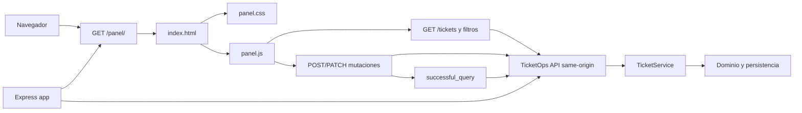

# Diseño técnico: TicketOps Panel

## Overview

TicketOps Panel será una interfaz web de una sola página para consultar, crear y operar tickets desde la misma aplicación que expone TicketOps API. El panel vivirá bajo `/panel/`, usará rutas relativas del mismo origen y mantendrá a la API como única fuente de verdad.

La implementación pública queda limitada a estos tres archivos:

- `public/panel/index.html`: estructura semántica, formularios, filtros, lista,
  regiones de estado y diálogos.
- `public/panel/panel.css`: composición visual, estados, foco accesible y
  comportamiento responsive.
- `public/panel/panel.js`: estado del cliente, adaptador HTTP, validaciones,
  renderizado seguro, sincronización y control de eventos.

No se añadirán frameworks, librerías de ejecución, módulos externos, fuentes,
iconos, imágenes, scripts inline ni hojas de estilo externas. El código del panel
será HTML, CSS y JavaScript nativos. Las dependencias de desarrollo para pruebas
no forman parte del producto servido al navegador.

El diseño conserva las decisiones aprobadas en `requirements.md`:

- `allowedTransitions` se añadirá de forma aditiva a las representaciones HTTP
  de tickets.
- El panel no inferirá acciones desde el estado, colores o etiquetas cuando la
  respuesta no contenga descriptores válidos.
- `Actor_Id` se pedirá en un campo visible y se conservará únicamente en
  `sessionStorage` durante la sesión de la pestaña.
- `GET /tickets/overdue` continuará protegido por el rol Supervisor.
- Una mutación exitosa sólo volverá a habilitar acciones después de una
  `successful_query` que haya aplicado la representación vigente.
- Un fallo de red en una mutación tendrá un único reintento automático. Si
  vuelve a fallar, el panel conservará el payload y ofrecerá un reintento manual.

El objetivo visual es una mesa de operación sobria, densa y legible: fondo claro
frío, superficies blancas, texto azul petróleo, acentos ámbar para vencimientos y
verde sólo como apoyo semántico. Las acciones, estados y errores siempre tendrán
texto explícito y no dependerán del color.

### Trazabilidad de alcance

El diseño cubre los Requirements 1–15 de `requirements.md`:

| Área | Requisitos cubiertos | Decisión de diseño |
|---|---:|---|
| Acceso, assets y estructura | 1, 15 | Montaje Express `/panel/` y sólo tres archivos públicos. |
| Indicadores y filtros | 2, 7 | Selectores puros, filtros remotos y respuesta activa. |
| Actor y autorización | 3, 7.4, 9, 10, 11 | `X-Actor-Id`, `sessionStorage` y mensajes por código. |
| Consultas y mutaciones | 4, 5, 9, 10 | Adaptador HTTP único, payloads explícitos y reconciliación. |
| Presentación y acciones | 6, 8 | Renderizado seguro y `allowedTransitions` como única fuente. |
| Errores y sincronización | 11 | Retry acotado, drafts preservados y `successful_query`. |
| Seguridad | 12 | Sinks textuales, rutas same-origin y ausencia de logging sensible. |
| Accesibilidad | 13 | HTML semántico, foco, diálogos, `aria-live` y contraste. |
| Responsive | 14 | Tarjetas apiladas y sin overflow horizontal a 375 px. |

## Architecture

### Vista general



### Capas y responsabilidades

#### Express y API

La aplicación Express será responsable de:

- Servir `public/panel/index.html`, `panel.css` y `panel.js` bajo `/panel/`.
- Mantener las rutas de tickets y sus contratos HTTP actuales.
- Añadir `allowedTransitions` a `GET /tickets` y `GET /tickets/:id`, además de
  las representaciones devueltas después de crear, asignar o cambiar estado.
- Calcular los descriptores con las reglas del servicio y del dominio, sin
  trasladar la máquina de estados al navegador.
- Seguir aplicando `X-Actor-Id`, el directorio de agentes y la autorización de
  Supervisor.
- Mantener los envelopes de error existentes y los códigos HTTP actuales.

La ampliación de `HttpTicket` es aditiva. Consumidores que ignoren campos
adicionales seguirán recibiendo los campos actuales. Panel_TicketOps, en cambio,
exigirá `allowedTransitions` para habilitar acciones.

#### `index.html`

El documento definirá:

- `header` con el título visible `TicketOps Panel de tickets` y el campo
  `Actor_Id`.
- `main` con una región de mensajes, indicadores, filtros y lista.
- `aside` para el formulario `Nuevo ticket`.
- Un contenedor principal para tarjetas o filas de tickets.
- Un `<dialog>` reutilizable para detalle, asignación y resolución.
- Regiones con nombres accesibles y `aria-live` para carga, éxito, error,
  contrato y reintento.

No contendrá datos de tickets, handlers inline, estilos inline ni scripts inline.
Cargará únicamente `./panel.css` y `./panel.js`.

#### `panel.css`

El CSS definirá un lenguaje visual deliberado y compacto:

- Fondo de trabajo `#eef2f4`, superficies `#ffffff`, texto principal `#15323a`
  y bordes `#b8c7cb`.
- Acento operativo azul petróleo `#0d6670` para acciones y enlaces.
- Ámbar `#9a5b00` y una insignia textual para tickets vencidos.
- Verde `#176b4d` para éxito, siempre acompañado por texto.
- Tipografía de sistema sin descargas externas, con una escala de lectura que
  priorice títulos y datos de tickets sin usar mayúsculas decorativas.
- Foco visible con `:focus-visible`, borde de al menos 3 px y contraste
  suficiente frente al fondo.
- `min-width: 0`, `overflow-wrap: anywhere` y acciones flexibles para textos
  largos.
- `@media (max-width: 375px)` para convertir filas en tarjetas apiladas y
  reordenar indicadores, formulario y lista verticalmente.
- `@media (prefers-reduced-motion: reduce)` para eliminar transiciones y
  desplazamientos no esenciales.

La composición de escritorio será una cuadrícula con indicadores en la parte
superior, formulario lateral y lista principal. En móvil, el flujo será:

```text
Encabezado y actor
Indicadores
Filtros
Nuevo ticket
Lista de tickets
```

#### `panel.js`

El archivo se organizará por funciones internas, sin convertir esas funciones en
una segunda capa de negocio:

1. Catálogos y etiquetas en español.
2. Validación y normalización de entradas.
3. Construcción segura de URLs, headers y bodies.
4. Parseo del contrato HTTP y errores estándar.
5. Selectores puros para indicadores, tiempos y fallbacks.
6. Renderizado con nodos y propiedades seguras.
7. Diálogos, foco y navegación por teclado.
8. Consultas, mutaciones, retry y reconciliación.
9. Delegación de eventos sobre contenedores propios.

El navegador conservará sólo estado de lectura y drafts de formularios. No
persistirá tickets, no evaluará reglas de SLA como fuente de verdad y no
reproducirá la máquina de estados de la API.

### Servido same-origin de `/panel/`

Express montará el directorio estático antes del router de negocio y antes del
fallback `ROUTE_NOT_FOUND`:

```text
panelRoot = resolve(
  dirname(fileURLToPath(import.meta.url)),
  '..',
  'public',
  'panel'
)
application.use('/panel', express.static(panelRoot, { index: 'index.html' }))
```

La ruta absoluta se calculará respecto al módulo ejecutado, no respecto al
working directory desde el que se inicia Node. En el build actual, el módulo
compilado queda en `dist/`, por lo que `.. /public/panel` apunta al directorio
público del proyecto.

El comportamiento esperado es:

- `GET /panel/` devuelve `index.html` con tipo `text/html`.
- `GET /panel/panel.css` devuelve sólo el CSS del panel.
- `GET /panel/panel.js` devuelve sólo el JavaScript del panel.
- Un asset inexistente no puede escapar de `public/panel` ni provocar una lectura
  de archivos arbitrarios.
- No se añade CORS, host, puerto, proxy ni origen separado.
- `/`, `/health`, el catálogo de API y las rutas `/tickets` mantienen su
  comportamiento actual.
- `/panel/` no se incorpora al catálogo de rutas de negocio ni altera los
  `405 Method Not Allowed` de la API.

`express.static` es el middleware integrado de Express para servir archivos CSS,
JavaScript y HTML, y admite un prefijo virtual para exponer un directorio bajo
una ruta distinta de su ubicación física. Esta decisión se basa en la
[documentación oficial de Express sobre archivos estáticos](https://expressjs.com/en/4x/starter/static-files/).

## Components and Interfaces

### Componentes de interfaz

| Componente | Archivo principal | Responsabilidad |
|---|---|---|
| Encabezado y actor | `index.html`, `panel.js` | Mostrar título, normalizar Actor_Id y persistirlo por pestaña. |
| Indicadores | `index.html`, `panel.js` | Mostrar Abiertos, Vencidos y Resueltos desde la colección vigente. |
| Filtros | `index.html`, `panel.js` | Todos, Solo vencidos y los seis estados permitidos. |
| Nuevo ticket | `index.html`, `panel.js` | Validar y enviar exactamente cinco propiedades. |
| Lista | `index.html`, `panel.js` | Mostrar datos, vencimiento, detalle y acciones. |
| Detalle | `<dialog>`, `panel.js` | Mostrar campos disponibles o `No disponible`. |
| Asignación | `<dialog>`, `panel.js` | Recibir `responsibleId`, conservarlo ante error y enviar PATCH. |
| Resolución | `<dialog>`, `panel.js` | Recibir nota obligatoria y enviar status `RESUELTO`. |
| Mensajes | `index.html`, `panel.js` | Anunciar carga, éxito, error, contrato y reintento. |

### Contrato HTTP utilizado por el panel

| Operación | Request | Éxito |
|---|---|---|
| Todos | `GET /tickets` | `200`, `HttpTicket[]` |
| Estado | `GET /tickets?status={STATUS}` | `200`, `HttpTicket[]` |
| Vencidos | `GET /tickets/overdue`, `X-Actor-Id` | `200`, `HttpTicket[]` |
| Detalle | `GET /tickets/:id` | `200`, `HttpTicket` |
| Crear | `POST /tickets`, body exacto de cinco campos | `201`, `HttpTicket` |
| Asignar | `PATCH /tickets/:id/assignment`, actor y `responsibleId` | `200`, `HttpTicket` |
| Estado | `PATCH /tickets/:id/status`, actor y `status` | `200`, `HttpTicket` |
| Resolver | `PATCH /tickets/:id/status`, actor y status/nota | `200`, `HttpTicket` |

Las URLs se construirán como rutas relativas al origen actual. Para `Todos` la
ruta será exactamente `/tickets`, sin filtros. El header `X-Actor-Id` sólo se
incluirá en assignment, status y overdue.

El adaptador HTTP será el único lugar que llamará a `fetch`. Configurará
`Content-Type: application/json` sólo cuando exista body, parseará JSON, validará
el status HTTP y convertirá el envelope estándar a un `ApiError` seguro. Usará
`AbortController` para timeout y cancelación de consultas. Fetch entrega una
promesa de respuesta que debe comprobarse por status antes de leer el cuerpo;
ese patrón se toma de la [guía de Fetch de MDN](https://developer.mozilla.org/en-US/docs/Web/API/Fetch_API/Using_Fetch) y del contrato de [AbortSignal](https://developer.mozilla.org/en-US/docs/Web/API/AbortSignal).

### Contrato de `allowedTransitions`

La API ampliará `HttpTicket` con una colección calculada por el servidor:

```ts
type AllowedAction =
  | 'ASSIGN'
  | 'START'
  | 'RESUME'
  | 'WAIT'
  | 'RESOLVE'
  | 'CLOSE'
  | 'REOPEN';

type AllowedInput =
  | 'RESPONSIBLE_ID'
  | 'NONE'
  | 'RESOLUTION_NOTE';

interface HttpAllowedTransition {
  action: AllowedAction;
  method: 'PATCH';
  href: string;
  targetStatus: TicketStatus | null;
  input: AllowedInput;
}

interface HttpTicket {
  id: string;
  title: string;
  description: string;
  category: Category;
  priority: Priority;
  requester: string;
  responsibleId: string | null;
  status: TicketStatus;
  createdAt: string;
  updatedAt: string;
  dueAt: string;
  resolutionNote: string | null;
  resolvedAt: string | null;
  closedAt: string | null;
  overdue: boolean;
  overdueCycle: number;
  escalations: HttpEscalation[];
  supervisorNotifications: HttpSupervisorNotification[];
  allowedTransitions: HttpAllowedTransition[];
}
```

Ejemplos:

```json
{
  "action": "ASSIGN",
  "method": "PATCH",
  "href": "/tickets/8d.../assignment",
  "targetStatus": null,
  "input": "RESPONSIBLE_ID"
}
```

```json
{
  "action": "RESOLVE",
  "method": "PATCH",
  "href": "/tickets/8d.../status",
  "targetStatus": "RESUELTO",
  "input": "RESOLUTION_NOTE"
}
```

Reglas del contrato:

- `ASSIGN` representa `PATCH /tickets/:id/assignment`, no una transición de
  estado enviada por el navegador. Su `targetStatus` es `null` y su input es
  `RESPONSIBLE_ID`.
- Las acciones de estado usan `PATCH /tickets/:id/status`, un `targetStatus`
  no nulo y `NONE` o `RESOLUTION_NOTE` según corresponda.
- `href` siempre será una ruta relativa del mismo origen y se construirá con el
  ID del ticket en el servidor.
- El servidor calculará la colección usando las reglas existentes de
  `TicketService`, `NORMAL_TRANSITIONS` y `REOPEN_TRANSITIONS`. El cliente no
  duplicará esas tablas.
- La asignación que produce `NUEVO -> ASIGNADO` se representa mediante
  `ASSIGN`; no se emitirá un botón `START` para esa transición.
- La tabla mínima de acciones de estado es:

| Estado actual | Descriptores de estado |
|---|---|
| `NUEVO` | Ninguno; la asignación se representa como `ASSIGN` cuando esté disponible. |
| `ASIGNADO` | `START -> EN_PROGRESO`. |
| `EN_PROGRESO` | `WAIT -> EN_ESPERA`, `RESOLVE -> RESUELTO`. |
| `EN_ESPERA` | `RESUME -> EN_PROGRESO`, `RESOLVE -> RESUELTO`. |
| `RESUELTO` | `CLOSE -> CERRADO`, `REOPEN -> EN_PROGRESO`. |
| `CERRADO` | `REOPEN -> EN_PROGRESO`. |

- La disponibilidad de `ASSIGN` seguirá la operación de asignación vigente del
  servicio. Si una regla futura la restringe, el servidor dejará de emitir el
  descriptor y el panel lo ocultará.
- `action` sólo se usa para elegir la etiqueta española y el diálogo. El panel
  usará `method`, `href`, `targetStatus` e `input` para construir la petición.
- Un descriptor ausente no puede producir un botón. Un estado local, color o
  etiqueta nunca puede producirlo.
- Si `allowedTransitions` falta, no es un arreglo o contiene descriptores que no
  cumplen el contrato, el ticket seguirá visible, pero la sección de acciones
  mostrará `No se pudieron cargar las acciones de este ticket.` sin botones.

El servidor debe añadir el campo al mapper de tickets para respuestas de lista,
detalle, creación, assignment y status. La validación final de una mutación
seguirá estando en `TicketService`; `allowedTransitions` sólo es una vista de
disponibilidad y no una autorización final.

### Modelo de estado del cliente

```ts
type FilterSelection =
  | { kind: 'ALL' }
  | { kind: 'OVERDUE' }
  | { kind: 'STATUS'; value: TicketStatus };

type AsyncPhase = 'idle' | 'loading' | 'success' | 'empty' | 'error';

type MutationState = {
  key: string;
  phase: 'idle' | 'loading' | 'retry-pending' | 'error';
  attempt: 0 | 1 | 2;
  operation: MutationOperation;
  preservedPayload: Record<string, string>;
};

interface QueryToken {
  sequence: number;
  filterKey: string;
  controller: AbortController;
}

interface PanelState {
  actorId: string;
  tickets: HttpTicket[];
  selectedFilter: FilterSelection;
  query: {
    phase: AsyncPhase;
    active: QueryToken | null;
    error: UiError | null;
  };
  mutation: MutationState | null;
  dialog:
    | { kind: 'detail' | 'assignment' | 'resolution'; ticketId: string }
    | null;
  lastDialogTrigger: HTMLElement | null;
  createDraft: Record<string, string>;
  dialogDraft: Record<string, string>;
  message: { kind: 'status' | 'error' | 'success'; text: string } | null;
}
```

#### Actor_Id

El panel usará una clave propia, por ejemplo `ticketops.actorId`, en
`sessionStorage`:

1. Leer el valor al arrancar.
2. Comprobar que sea string y que `trim()` produzca un valor no vacío.
3. Guardar sólo el valor normalizado.
4. Usarlo en el campo visible y en `X-Actor-Id` para assignment, status y
   overdue.
5. Volver a solicitarlo si no existe o no es válido.

No se usará `localStorage`, cookies, URL ni consola. Las consultas generales de
`GET /tickets` no quedarán bloqueadas por la falta de actor; las operaciones que
lo requieren sí.

#### Filtros

El filtro seleccionado tendrá una identidad estable:

- `ALL` construye `GET /tickets`.
- `STATUS` construye `GET /tickets?status={STATUS}`.
- `OVERDUE` construye `GET /tickets/overdue` con `X-Actor-Id`.

Al cambiar el filtro se incrementa un contador monotónico, se crea un nuevo
`AbortController` y se muestra `cargando`. La selección visible se conserva si
la consulta falla. Un `403` en `OVERDUE` mantiene el filtro seleccionado y ofrece
una acción explícita para volver a `Todos`.

#### Indicadores

Los indicadores se calculan siempre sobre `state.tickets`, la última colección
aceptada:

- `Abiertos`: `NUEVO`, `ASIGNADO`, `EN_PROGRESO`, `EN_ESPERA`.
- `Vencidos`: `overdue === true`.
- `Resueltos`: `RESUELTO`, `CERRADO`.

Una colección vacía produce tres ceros. Ningún indicador se actualizará con una
respuesta obsoleta o con un cambio optimista.

#### Control de respuestas obsoletas

Cada consulta tendrá un `QueryToken` con `sequence` y la identidad del filtro.
Sólo se aplicará una respuesta cuando:

- su `sequence` sea la activa;
- el filtro aún coincida con `selectedFilter`;
- la respuesta tenga la forma esperada;
- la consulta no haya sido abortada como obsoleta.

Una respuesta tardía no puede reemplazar `tickets`, `query.phase`, indicadores
ni mensajes de la consulta activa. El cliente puede abortar la consulta anterior
para liberar recursos, pero la comprobación del token seguirá siendo obligatoria.

#### `successful_query` y mutaciones

`successful_query` es una operación de lectura posterior que termina correctamente
y aplica la representación vigente del ticket y de la colección.

Después de `POST /tickets`:

1. Aceptar el `201` y mostrar el mensaje de éxito.
2. Limpiar el formulario de creación.
3. Ejecutar la consulta del filtro activo.
4. Recalcular indicadores sólo con la colección aceptada.

Después de assignment o status:

1. Mantener bloqueadas las acciones del ticket.
2. Aceptar la respuesta de la mutación sólo como confirmación de éxito.
3. Ejecutar `GET /tickets/:id` para obtener la representación vigente.
4. Ejecutar la consulta de lista activa para actualizar indicadores y orden.
5. Aplicar ambas respuestas sólo si sus tokens siguen siendo actuales.
6. Cerrar el diálogo asociado y anunciar éxito únicamente después de completar
   la reconciliación requerida.
7. Volver a habilitar acciones sólo después de aplicar `successful_query`.

Si la consulta posterior falla, las acciones permanecen bloqueadas y el panel no
presenta la mutación como sincronizada. Una respuesta vigente elimina acciones
obsoletas y conserva el ciclo de vencimiento, escalaciones y notificaciones que
la API haya devuelto.

### Indicadores temporales y detalle

Las fechas llegan en ISO UTC. El formateador recibe el instante actual como
argumento para ser determinista en pruebas:

- `dueAt` futuro: mostrar `en ...` con el tiempo restante.
- `overdue === true` o `dueAt` pasado para un ticket vigente: mostrar un texto
  que empiece por `hace ...` y una insignia textual `VENCIDO`.
- La palabra `VENCIDO` estará en el árbol de texto y accesible, no en un
  pseudo-elemento ni sólo en una clase de color.

El detalle mostrará descripción, solicitante, responsable, fechas relevantes y
nota de resolución cuando existan. Un valor ausente o `null` se representará como
`No disponible` junto a una etiqueta explícita. `responsibleId` se mostrará como
identificador opaco porque la API actual no expone un catálogo de agentes.

## Data Models

### Catálogos visibles

```ts
type Category =
  | 'INFRAESTRUCTURA'
  | 'ACCESOS'
  | 'APLICACIONES'
  | 'INSTALACIONES';

type Priority = 'CRITICA' | 'ALTA' | 'MEDIA' | 'BAJA';

type TicketStatus =
  | 'NUEVO'
  | 'ASIGNADO'
  | 'EN_PROGRESO'
  | 'EN_ESPERA'
  | 'RESUELTO'
  | 'CERRADO';
```

Las etiquetas visibles serán:

```text
INFRAESTRUCTURA -> Infraestructura
ACCESOS         -> Accesos
APLICACIONES    -> Aplicaciones
INSTALACIONES   -> Instalaciones

CRITICA -> Crítica
ALTA    -> Alta
MEDIA   -> Media
BAJA    -> Baja

NUEVO        -> Nuevo
ASIGNADO     -> Asignado
EN_PROGRESO  -> En progreso
EN_ESPERA    -> En espera
RESUELTO     -> Resuelto
CERRADO      -> Cerrado
```

### Requests

Creación, sin claves adicionales:

```json
{
  "title": "No funciona el acceso VPN",
  "description": "El usuario no puede conectarse desde la oficina.",
  "category": "ACCESOS",
  "priority": "ALTA",
  "requester": "user-123"
}
```

Asignación:

```json
{ "responsibleId": "agent-123" }
```

Transición normal:

```json
{ "status": "EN_ESPERA" }
```

Resolución:

```json
{
  "status": "RESUELTO",
  "resolutionNote": "Se restableció el acceso y se verificó la conexión."
}
```

El panel hará `trim()` de textos libres antes de enviarlos, pero conservará
exactamente los valores de catálogo. El body de creación se construirá con una
lista explícita de cinco propiedades; nunca se serializará el objeto completo del
formulario.

### Error estándar y error de interfaz

```ts
interface StandardErrorBody {
  error: {
    code:
      | 'INVALID_REQUEST'
      | 'INVALID_JSON'
      | 'ACTOR_REQUIRED'
      | 'ACTOR_UNKNOWN'
      | 'SUPERVISOR_REQUIRED'
      | 'TICKET_NOT_FOUND'
      | 'AGENT_UNAVAILABLE'
      | 'INVALID_TRANSITION'
      | 'ROUTE_NOT_FOUND'
      | 'METHOD_NOT_ALLOWED'
      | 'INTERNAL_ERROR';
    message: string;
    details?: Array<{
      path?: Array<string | number>;
      message?: string;
      code?: string;
    }>;
  };
}
```

`UiError` contendrá `code`, `summary`, `fieldErrors`, `generalDetails`,
`retryable` y `preservedOperation`. No contendrá stacks, responses completas,
Actor_Id ni textos sensibles para logging.

Mapa mínimo visible:

| Código | Mensaje visible | Recuperación |
|---|---|---|
| `ACTOR_REQUIRED` | El identificador del actor es obligatorio. | Enfocar Actor_Id. |
| `ACTOR_UNKNOWN` | El identificador del actor no es válido. | Conservarlo para corregirlo. |
| `SUPERVISOR_REQUIRED` | Este actor no tiene permisos de supervisor. | Ofrecer volver a Todos. |
| `AGENT_UNAVAILABLE` | El agente no existe o no está activo. | Mantener abierto Asignar. |
| `INVALID_TRANSITION` | El ticket cambió y la acción ya no es válida. | Reconsultar el ticket. |
| `TICKET_NOT_FOUND` | El ticket ya no existe. | Actualizar la lista. |
| `INVALID_REQUEST` | Revisa los datos introducidos. | Asociar detalles y conservar draft. |
| Red o timeout | No se pudo conectar con TicketOps. | Retry definido por la operación. |
| `INTERNAL_ERROR` | Ocurrió un error del servidor. | Reintento manual si corresponde. |

Los `details` con paths conocidos se asociarán a campos. Los restantes se
mostrarán como texto general útil. No se expondrán trazas internas ni valores
sensibles.

## Correctness Properties

Una propiedad de corrección es una característica o comportamiento que debe
mantenerse en todas las ejecuciones válidas del sistema. Estas propiedades se
aplican a funciones puras y a adaptadores controlados del panel. Las pruebas de
navegador, accesibilidad y Express se especifican aparte porque dependen del DOM,
la red o el entorno de ejecución.

### Property 1: Indicadores correctos para cualquier colección

Para cualquier colección válida de tickets, `Abiertos` contará exactamente los
estados `NUEVO`, `ASIGNADO`, `EN_PROGRESO` y `EN_ESPERA`, `Vencidos` contará
exactamente los tickets con `overdue === true` y `Resueltos` contará exactamente
`RESUELTO` y `CERRADO`; para una colección vacía los tres valores serán cero.

**Validates: Requirements 2.2, 2.3, 2.4, 2.6**

### Property 2: Body de creación exacto

Para cualquier formulario válido, el body construido para `POST /tickets`
contendrá exactamente `title`, `description`, `category`, `priority` y
`requester`, con textos normalizados, y no contendrá `responsibleId`,
`responsible` ni `responsable`.

**Validates: Requirements 5.4, 5.6, 5.7, 12.4, 15.3**

### Property 3: Validación de textos y límites

Para cualquier texto de formulario, un valor que quede vacío después de
`trim()` será rechazado; un título de longitud entre 1 y 120 será aceptado; y un
título de longitud superior a 120 será rechazado con un error asociado a `title`.

**Validates: Requirements 3.3, 5.4, 5.5, 9.2, 10.3**

### Property 4: Construcción de consultas y actor

Para cualquier estado permitido, el adaptador construirá
`GET /tickets?status={estado}`; para `Todos` construirá `/tickets` sin filtros; y
para `Solo vencidos` construirá `/tickets/overdue` y exigirá un `Actor_Id`
normalizado en `X-Actor-Id`.

**Validates: Requirements 3.2, 7.2, 7.3, 7.4, 12.4**

### Property 5: Acciones exactamente derivadas de descriptors

Para cualquier ticket y cualquier colección válida de `allowedTransitions`, los
controles de acciones renderizados corresponderán uno a uno con los descriptors
recibidos y usarán la etiqueta asociada a `action`; si falta un descriptor, la
acción no aparecerá y ningún estado local podrá crearla.

**Validates: Requirements 8.1, 8.2, 8.3, 8.4, 8.5, 8.6, 8.7, 8.8, 8.9**

### Property 6: Requests compatibles con el input del descriptor

Para cualquier descriptor válido de asignación o estado, la mutación construida
usará su `method` y `href` same-origin, incluirá el `X-Actor-Id` normalizado y
serializará sólo `responsibleId`, `status` o `resolutionNote` según `input`, sin
claves de otra operación.

**Validates: Requirements 8.11, 9.3, 10.1, 10.4, 12.4, 15.3**

### Property 7: Presentación temporal con señal textual

Para cualquier instante actual y cualquier `dueAt`, si la fecha es futura el
texto expresará tiempo restante; si el ticket está vencido por `overdue` o por
fecha pasada permitida por la respuesta, el texto comenzará por `hace` y
contendrá `VENCIDO`; estas señales existirán como texto y no dependerán del
color.

**Validates: Requirements 6.3, 6.4, 6.5, 13.9**

### Property 8: Fallback explícito del detalle

Para cualquier ticket y cualquier combinación de valores opcionales ausentes, el
detalle mostrará el valor recibido cuando exista y mostrará `No disponible` con
una etiqueta explícita cuando falte.

**Validates: Requirements 6.6**

### Property 9: Renderizado literal seguro

Para cualquier string que contenga etiquetas, atributos, entidades o secuencias
de script, el renderizador lo colocará como texto literal mediante
`textContent`, `createTextNode`, `value` o una propiedad equivalente segura; el
resultado no creará elementos derivados del string ni ejecutará código.

**Validates: Requirements 6.7, 12.1, 12.2**

### Property 10: Details de validación y conservación del draft

Para cualquier respuesta `INVALID_REQUEST`, los paths que correspondan a campos
conocidos se asociarán al campo correcto, los restantes se mostrarán como
mensaje general y ningún valor válido del formulario se borrará.

**Validates: Requirements 5.9, 11.2**

### Property 11: Retry de mutación acotado y reproducible

Para cualquier operación de mutación con payload preservable, un fallo de red o
timeout producirá como máximo dos envíos; el segundo usará el mismo método, ruta,
actor y body; si ambos fallan, el estado conservará el payload y ofrecerá un
reintento manual.

**Validates: Requirements 11.5, 11.6**

### Property 12: Sólo la consulta activa reemplaza el estado

Para cualquier secuencia de consultas iniciadas con filtros distintos y cualquier
orden de resolución de sus respuestas, sólo la respuesta cuyo token coincide con
la consulta activa podrá reemplazar `tickets`, `query.phase`, indicadores y
contenido visible.

**Validates: Requirements 4.5, 4.6, 7.5, 15.4**

### Property 13: `successful_query` precede la reactivación

Para cualquier mutación exitosa y cualquier resultado de la consulta posterior,
las acciones del ticket permanecerán deshabilitadas hasta que una
`successful_query` válida haya aplicado la representación vigente; una consulta
fallida u obsoleta no podrá presentarse como sincronización exitosa ni conservar
acciones obsoletas.

**Validates: Requirements 10.5, 11.3, 15.4**

### Reflexión de redundancias

La reflexión posterior al prework consolida sólo propiedades que prueban la misma
invariante:

- Las reglas de los tres indicadores y la colección vacía forman una sola
  propiedad porque son selectores independientes sobre la misma colección.
- La forma exacta del body de creación y la exclusión de responsables se validan
  como un conjunto exacto de claves.
- La disponibilidad y ausencia de acciones se validan mediante correspondencia
  exacta con `allowedTransitions`; los nombres concretos de cada acción se
  mantienen como ejemplos de contrato.
- El retry automático y el reintento manual pertenecen a una única máquina de
  estados con payload inmutable.
- Las respuestas obsoletas y la precondición `successful_query` se mantienen en
  propiedades separadas: una protege consultas concurrentes y la otra protege la
  reactivación de acciones después de mutaciones.
- Las propiedades de renderizado seguro y asociación de errores se mantienen
  separadas porque protegen sinks y semánticas distintas.

## Error Handling

### Clasificación

1. **Validación local**: no llama a la API, muestra errores junto a campos y
   conserva el draft.
2. **Error HTTP estándar**: parsea `{ error: { code, message, details } }`, usa
   el mapa de códigos y aplica la recuperación específica.
3. **Red o timeout en consulta**: conserva la colección anterior, muestra
   `error de conexión` y ofrece reintento.
4. **Red o timeout en mutación**: conserva payload y ejecuta un único retry
   automático.
5. **Error de contrato**: mantiene visible el ticket, anuncia que no se pudieron
   cargar las acciones y no infiere botones.
6. **Error inesperado de cliente**: muestra un mensaje genérico en español sin
   incluir stack ni datos de usuario.

### Retry de mutaciones

El retry automático sólo aplica a fallos sin respuesta HTTP confiable: rechazo de
`fetch`, timeout o desconexión. No se repiten automáticamente respuestas `400`,
`403`, `404`, `409` ni `500`, porque podrían duplicar efectos o esconder un
conflicto que ya recibió respuesta.

Secuencia:

1. Intento inicial: `phase = loading`, control deshabilitado.
2. Fallo de red: copiar método, href, actor y body a `preservedPayload`.
3. Anunciar que se hará un único reintento automático.
4. Intento automático: reutilizar exactamente la copia preservada.
5. Éxito: descartar payload, ejecutar `successful_query` y sólo entonces
   habilitar acciones.
6. Segundo fallo: `phase = error`, conservar payload y mostrar `Reintentar`.
7. Reintento manual: usar el payload conservado sin mezclarlo con cambios
   posteriores de otro formulario.

Un click repetido no crea dos operaciones pendientes. Una edición posterior del
formulario inicia una operación nueva; nunca modifica silenciosamente el payload
de una operación que ya falló.

### Recuperación por código

- `ACTOR_REQUIRED` y `ACTOR_UNKNOWN`: mostrar error, enfocar Actor_Id y no
  reintentar automáticamente.
- `SUPERVISOR_REQUIRED`: mantener visible `Solo vencidos`, explicar el permiso y
  ofrecer `Todos`.
- `AGENT_UNAVAILABLE`: mantener abierto el diálogo de asignación.
- `INVALID_TRANSITION`: no anunciar éxito, consultar el ticket y retirar acciones
  obsoletas.
- `TICKET_NOT_FOUND`: cerrar el diálogo, anunciar que el ticket ya no existe y
  consultar la lista.
- `INVALID_REQUEST`: asociar `details`, conservar valores y no limpiar el
  formulario.
- `INTERNAL_ERROR`: mostrar mensaje general; no reintentar una mutación si ya se
  recibió una respuesta HTTP.

## Accessibility and responsive behavior

### WCAG 2.1 AA

El panel usará HTML semántico, nombres visibles y atributos ARIA sólo cuando
aporten información que el HTML nativo no pueda expresar. El diseño cubrirá:

- Cada control tendrá label visible, `id` estable y nombre accesible.
- Todos los controles, tarjetas accionables, filtros, diálogos y reintentos serán
  operables con teclado.
- Cada elemento enfocado tendrá un indicador visible; no se eliminará el outline
  sin reemplazo equivalente.
- Texto, controles, foco e información de vencimiento tendrán contraste suficiente
  y no dependerán sólo del color.
- `VENCIDO` aparecerá como texto accesible.
- Los errores usarán `aria-invalid`, `aria-describedby` y una región de anuncio.
- Los estados de carga, éxito y error se comunicarán mediante una región con
  nombre accesible y `aria-live="polite"`; los errores urgentes podrán usar
  `assertive` sólo cuando sea necesario.
- `prefers-reduced-motion: reduce` eliminará animaciones y transiciones no
  esenciales.

Las técnicas de foco visible y accesibilidad se contrastarán con la guía de
[WCAG 2.1](https://www.w3.org/WAI/WCAG21/Understanding/) y sus técnicas
publicadas por W3C.

### Diálogos y foco

Se usará `<dialog>` con `showModal()` cuando esté disponible. El controlador
conservará el elemento que abrió el diálogo y aplicará este ciclo:

1. Asignar nombre accesible mediante `aria-labelledby`.
2. Mover el foco al primer campo operativo o al título cuando el contenido sea
   sólo lectura.
3. Mantener Tab y Shift+Tab dentro del diálogo.
4. Cerrar con el botón Cancelar o Escape.
5. Evitar que una mutación pendiente permita doble envío.
6. Devolver el foco al disparador al cerrar.

Detalle, asignación y resolución compartirán la superficie modal, pero tendrán
contenido, validación y acciones distintas. Esta decisión sigue el patrón de
[diálogo modal de WAI-ARIA](https://www.w3.org/WAI/ARIA/apg/patterns/dialog-modal/).

### Responsive a 375 px

A 375 px o menos:

- Cada fila será una tarjeta apilada.
- Título, estado, vencimiento y acciones permanecerán visibles.
- Los textos largos podrán partirse con `overflow-wrap: anywhere`.
- No se usará una tabla con overflow horizontal para ocultar acciones.
- El formulario lateral pasará al flujo vertical después de filtros e indicadores.
- Los controles conservarán nombres accesibles, foco visible y un área operable
  suficiente.

La prueba de navegador verificará `scrollWidth <= clientWidth`, texto largo,
visibilidad de acciones y operación por teclado en ese viewport.

## Testing Strategy

### Decisión sobre PBT

PBT es apropiado para la lógica pura del panel: validación, normalización,
contadores, construcción de URLs y bodies, mapeo de descriptores, tiempos,
fallbacks, renderizado textual seguro, tokens de consulta y máquina de retry
simulada. No se usará PBT para afirmar comportamiento visual de un navegador,
contraste, foco real, Express o servicios externos.

El proyecto ya incluye `fast-check` como dependencia de desarrollo, junto con
Vitest, Supertest y TypeScript. Cada propiedad tendrá una prueba independiente,
con un mínimo de 100 ejecuciones:

```text
fc.assert(property, { numRuns: 100 })
```

Cada prueba incluirá un comentario con el formato:

```text
Feature: ticketops-panel, Property N: <texto de la propiedad>
```

El código de producción seguirá limitado a los tres archivos públicos. Para
probar funciones puras de `panel.js`, el diseño permite una superficie de prueba
controlada o carga del script en un entorno de navegador; no se añadirá una
biblioteca al runtime del panel.

### Pruebas unitarias y de propiedades

- Properties 1–13: una prueba PBT por propiedad, con al menos 100 casos.
- Ejemplos de borde para longitudes 120/121, campos whitespace y colecciones
  vacías.
- Catálogos completos de categorías, prioridades, estados y acciones.
- Requests exactos de creación, assignment, status y resolución.
- Parseo de errors estándar y asociación de `details` a campos.
- Timeout, cancelación y separación entre fallos de red y respuestas HTTP.
- Ausencia de sinks inseguros y logging sensible.

### Pruebas de Express e integración HTTP

Con `createApp` y Supertest se verificará:

- `GET /panel/` y los dos assets devuelven contenido y tipos correctos.
- Los assets no permiten path traversal ni se sirven desde otra ruta.
- La API mantiene el catálogo y comportamiento actual de `/`, `/health` y
  `/tickets`.
- `GET /tickets` y `GET /tickets/:id` incluyen `allowedTransitions` con forma
  exacta.
- Cada estado produce los descriptors de estado esperados y `ASSIGN` usa
  `/assignment`.
- Actor, overdue, asignación, status, errores y códigos HTTP conservan sus
  contratos.
- Una respuesta sin `allowedTransitions` no causa inferencia de acciones.

### Pruebas de navegador

Se usará un runner de navegador como dependencia de desarrollo, sin incluirlo en
el panel servido, contra la aplicación local o un mock same-origin controlado.
La suite cubrirá:

- Carga inicial, refresco, colección vacía, caída de red, timeout y reintento.
- Creación válida, whitespace, límites 120/121, detalles de validación y
  limpieza tras `201`.
- Rutas y payloads exactos mediante interceptación de requests.
- Actor en `sessionStorage`, ausencia de actor y errores de actor.
- `Solo vencidos` mediante `/tickets/overdue`, sin filtrado local sustituto.
- Indicadores, catálogos, tiempos, `VENCIDO`, detalle y `No disponible`.
- Acciones exclusivamente derivadas de fixtures de `allowedTransitions`.
- successful_query, acciones obsoletas, `AGENT_UNAVAILABLE`,
  `INVALID_TRANSITION` y `TICKET_NOT_FOUND`.
- Mensajes en español, `aria-live`, `aria-invalid`, `aria-describedby`, nombre
  de diálogos, foco inicial, ciclo Tab/Shift+Tab, Escape y restauración de foco.
- Teclado completo, foco visible, contraste, reduced motion y ausencia de
  solicitudes externas.
- Viewport de 375 px, ausencia de scroll horizontal y texto largo.
- Payloads con `<script>`, atributos, entidades y markup sin ejecución.

### Trazabilidad de pruebas

| Requisitos | Pruebas principales |
|---|---|
| 1, 15 | Integración de assets, auditoría estática y smoke de dependencias. |
| 2, 6, 7 | Properties 1, 4, 7, 8 y pruebas de navegador de filtros/render. |
| 3, 9, 10 | Properties 3, 4, 6 y pruebas de dialogs/headers/PATCH. |
| 4, 5 | Properties 2, 3, 10, 12 y pruebas HTTP de lectura/creación. |
| 8 | Property 5, Property 6 y contrato de descriptors. |
| 11 | Properties 10, 11, 12, 13 y fallos simulados de red. |
| 12 | Property 9, auditoría de sinks y prueba de requests same-origin. |
| 13 | Pruebas de navegador, foco, ARIA, contraste y reduced motion. |
| 14 | Pruebas de viewport de 375 px y contenido largo. |

## Dependencias y riesgos

| Dependencia o riesgo | Impacto | Mitigación |
|---|---|---|
| `HttpTicket` actual no tiene `allowedTransitions` | El panel no puede mostrar acciones correctas. | Cambio aditivo del mapper, contrato y pruebas; ausencia produce error no bloqueante. |
| Express todavía no monta `public/panel` | `/panel/` no estará disponible. | Montaje explícito antes del fallback, con raíz absoluta segura. |
| No hay login ni catálogo de agentes | Actor y responsable se introducen manualmente. | Campo Actor_Id en `sessionStorage` y diálogo de `responsibleId`. |
| `/tickets/overdue` exige Supervisor | Algunos actores no podrán usar el filtro. | Mensaje específico y acción para volver a `Todos`; no simular con filtrado local. |
| Respuestas asíncronas obsoletas | La lista o las acciones podrían mostrar estado viejo. | Tokens monotónicos, aborto de consultas y condición `successful_query`. |
| Pérdida de respuesta tras una mutación | Un retry podría duplicar un efecto ya aplicado en servidor. | Sólo un retry automático ante fallo sin respuesta HTTP; no reintentar conflictos HTTP. |
| Contrato antiguo durante despliegue | El panel podría recibir tickets sin acciones. | Despliegue coordinado y error de contrato visible sin inferencia temporal. |
| `<dialog>` varía entre navegadores | El foco modal podría degradarse. | Target de navegadores modernos, control explícito de foco y pruebas de teclado. |
| `public/` no participa en `tsc` | El build puede no copiar assets. | El empaquetado debe entregar `public/panel` junto con `dist`; no se compila como TypeScript. |
| No hay runner de navegador en las dependencias actuales | Las pruebas visuales no pueden ejecutarse todavía. | Seleccionar una dependencia de desarrollo en la fase de implementación; mantener PBT e integración en Vitest/Supertest. |
| Textos técnicos de API están en inglés | Incumplimiento de la interfaz en español. | Mapa por código, traducción de details conocidos y exclusión de trazas. |
| Texto remoto llega con markup | Riesgo XSS. | `textContent`, `createTextNode`, `value`, sin `innerHTML` ni equivalentes. |

### Fuentes técnicas consultadas

- [Express: Serving static files](https://expressjs.com/en/4x/starter/static-files/)
- [MDN: Using the Fetch API](https://developer.mozilla.org/en-US/docs/Web/API/Fetch_API/Using_Fetch)
- [MDN: AbortSignal](https://developer.mozilla.org/en-US/docs/Web/API/AbortSignal)
- [WAI-ARIA APG: Dialog Modal Pattern](https://www.w3.org/WAI/ARIA/apg/patterns/dialog-modal/)
- [W3C: Understanding WCAG 2.1](https://www.w3.org/WAI/WCAG21/Understanding/)

Contenido reexpresado para cumplir las restricciones de licencia y atribución.

Este documento sólo actualiza el diseño técnico. No crea `tasks.md` ni modifica
código de producción.
