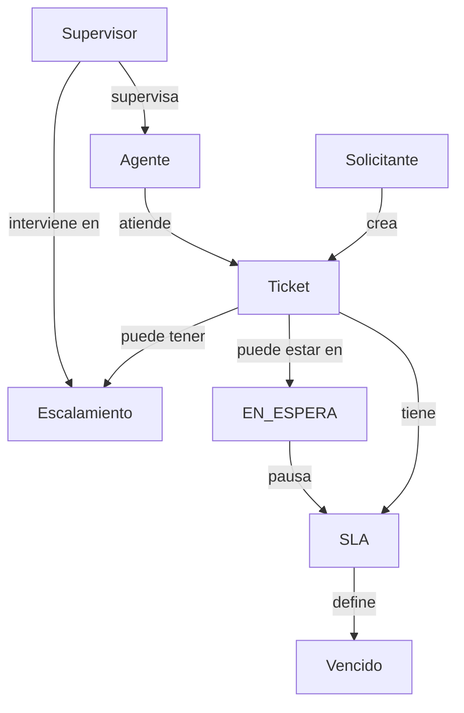

# Glosario de Tickets - TallerKiro

Este steering define los términos clave del dominio de tickets de soporte en el sistema TallerKiro. Se aplica manualmente cuando se escribe `#glosario-tickets` en el chat.

## Términos del dominio

### Ticket
**Definición**: Un registro formal de una incidencia o solicitud de soporte reportada por un colaborador. Representa la unidad fundamental de trabajo en el sistema.

**Características**:
- Identificador único (UUID)
- Título y descripción del problema
- Categoría: INFRAESTRUCTURA, ACCESOS, APLICACIONES, INSTALACIONES
- Prioridad: CRITICA, ALTA, MEDIA, BAJA
- Estado actual (ver estados posibles)
- Historial de transiciones de estado
- Actor asignado (agente o supervisor)
- Tiempos de creación, asignación, resolución y cierre

**Reglas de negocio**:
- Nunca se elimina un ticket, solo se cierra
- Todo ticket tiene un ciclo de vida completo
- Los tickets CRITICA requieren atención inmediata

### SLA (Service Level Agreement)
**Definición**: Acuerdo de nivel de servicio que define los tiempos máximos de respuesta y resolución para tickets según su prioridad.

**Cálculos**:
- **Tiempo de respuesta**: Intervalo desde la creación hasta la asignación a un agente
- **Tiempo de resolución**: Intervalo desde la creación hasta el estado RESUELTO
- **Tiempos según prioridad**:
  - CRITICA: Respuesta 15 min, Resolución 2 horas
  - ALTA: Respuesta 1 hora, Resolución 8 horas  
  - MEDIA: Respuesta 4 horas, Resolución 24 horas
  - BAJA: Respuesta 8 horas, Resolución 72 horas

**Regla especial**: El SLA se **PAUSA** mientras el ticket está en estado EN_ESPERA

### Escalamiento
**Definición**: Proceso automático o manual de transferir un ticket a un nivel superior de atención cuando no se cumple el SLA o se requiere intervención especializada.

**Ciclos de escalamiento**:
1. **Ciclo 1**: Ticket asignado pero sin avance dentro del tiempo SLA
2. **Ciclo 2**: Ticket ya escalado pero sigue sin resolución
3. **Ciclo 3**: Ticket requiere intervención directa del supervisor

**Reglas de escalamiento**:
- Un ticket CRITICA se escala al supervisor si no tiene responsable en 15 minutos
- Los supervisores son notificados en ciclos de escalamiento específicos
- Cada ciclo incrementa la urgencia y notifica a más stakeholders

### Vencido
**Definición**: Un ticket que ha excedido los tiempos establecidos en su SLA sin haber sido resuelto.

**Criterios**:
- Ha superado el tiempo máximo de respuesta sin ser asignado
- Ha superado el tiempo máximo de resolución sin llegar a estado RESUELTO
- Está en escalamiento activo por incumplimiento de SLA

**Consecuencias**:
- Dispara procesos de escalamiento automático
- Genera notificaciones a supervisores
- Afecta métricas de desempeño del equipo

### Solicitante
**Definición**: Cualquier colaborador de la organización que reporta una incidencia o realiza una solicitud de soporte.

**Características**:
- No requiere permisos especiales en el sistema
- Puede crear nuevos tickets
- Puede consultar el estado de sus tickets reportados
- Recibe notificaciones sobre actualizaciones de sus tickets

**Responsabilidades**:
- Proporcionar información clara y completa al crear el ticket
- Responder a consultas de los agentes cuando se solicita información adicional
- Confirmar la resolución del problema

### Agente
**Definición**: Miembro del equipo de soporte responsable de resolver tickets asignados.

**Permisos**:
- Ver tickets asignados y disponibles
- Actualizar estado de tickets (ASIGNADO → EN_PROGRESO → EN_ESPERA → RESUELTO)
- Agregar notas y actualizaciones al ticket
- Reasignar tickets a otros agentes cuando sea necesario

**Responsabilidades**:
- Atender tickets dentro de los tiempos SLA
- Comunicarse con solicitantes para obtener información adicional
- Documentar soluciones aplicadas
- Escalar tickets cuando se requiere intervención especializada

### Supervisor
**Definición**: Miembro senior del equipo con responsabilidades de supervisión y toma de decisiones.

**Permisos especiales**:
- Ver todos los tickets del sistema
- Reasignar tickets entre agentes
- Forzar escalamientos
- Revisar tickets vencidos y en escalamiento
- Tomar posesión de tickets críticos

**Responsabilidades**:
- Revisar tickets vencidos periódicamente
- Intervenir en tickets CRITICA no asignados en 15 minutos
- Gestionar recursos del equipo según carga de trabajo
- Aprobar soluciones complejas o de alto impacto

### Estado EN_ESPERA
**Definición**: Estado temporal en el que un ticket requiere información adicional del solicitante o depende de factores externos para continuar.

**Características clave**:
- El ticket está **activo** pero no en progreso activo
- El **SLA SE PAUSA** mientras el ticket está en este estado
- El tiempo en EN_ESPERA no cuenta para el cálculo de tiempos de resolución

**Transiciones permitidas**:
- EN_PROGRESO → EN_ESPERA (cuando se necesita información)
- EN_ESPERA → EN_PROGRESO (cuando se obtiene la información)
- EN_ESPERA → RESUELTO (si la espera resuelve el problema)

**Casos de uso**:
1. Esperando respuesta del solicitante a una consulta
2. Dependiendo de un proveedor externo
3. Esperando aprobación de un cambio
4. En espera de disponibilidad de recursos

## Relaciones entre términos

## Reglas de negocio clave

1. **Regla de pausa SLA**: Cuando un ticket entra en EN_ESPERA, el cronómetro del SLA se detiene hasta que vuelve a EN_PROGRESO.

2. **Regla de escalamiento CRITICA**: Tickets con prioridad CRITICA deben escalarse al supervisor si no tienen agente asignado en 15 minutos.

3. **Regla de no eliminación**: Los tickets nunca se eliminan del sistema, solo se cierran, manteniendo el historial completo.

4. **Regla de ciclos de escalamiento**: Los tickets vencidos escalan a través de ciclos predefinidos con notificaciones incrementales.

5. **Regla de comunicación**: Todos los mensajes a usuarios deben ser breves, en español neutro y sin tecnicismos innecesarios.
